# Geometric optimization of loudspeaker arrays

*[maujabur/bean-forming-lab](https://github.com/maujabur/bean-forming-lab) · made with Kiro*

Comparison of regular, perturbed, spiral, ring and optimized layouts with 8, 16 and 32 elements on a flat panel, separating the effect of the **number of elements**, of the **aperture** and of the **spatial distribution**. The acoustic model is the one of the earlier missions: ideal omnidirectional point sources, free field, `1/r` attenuation, real focusing delays, speed of sound 343 m/s, spectral integration by weighted mean-square pressures (`docs/broadband-study.md`). **Only the speaker positions are optimized.** Nothing here is a measurement, and the 65 mm driver diameter is a study hypothesis, not a measured dimension of the hardware: replace it with the real driver size before any manufacturing decision.

## Method

### Mechanical constraints (all configurable)

| Parameter | Default | Meaning |
|---|---|---|
| Panel | 420 x 420 mm (also 260, 520, 630, 840) | physical envelope, centered at the origin, in the plane z = 0, normal +z |
| Reference diameter | 65 mm | **hypothesis**, to be replaced by the real driver |
| Minimum center distance | 65 mm | drivers do not overlap |
| Edge margin | 32.5 mm | center to panel edge (the driver radius) |

The centers therefore live in a 355 x 355 mm square on the 420 mm panel. Every generated layout is validated; an invalid layout never enters the acoustic evaluation and **nothing is repaired silently**. Infeasible combinations are recorded with their reason:

| Layout | Reason (never relaxed) |
|---|---|
| R32-E420 | minimum center distance 50.714 mm < 65 mm |
| V32-E420 | edge clearance -14.521 mm < margin 32.5 mm |
| C32-E420 | no ring structure is valid (2 rings: minimum center distance 50.008 mm < 65 mm; 3 rings: minimum center distance 59.223 mm < 65 mm; 4 rings: minimum center distance 44.375 mm < 65 mm) |
| J32-E420-s1 | minimum center distance 50.714 mm < 65 mm |
| J32-E420-s2 | minimum center distance 50.714 mm < 65 mm |
| J32-E420-s3 | minimum center distance 50.714 mm < 65 mm |
| V8-E260 | edge clearance 26.486 mm < margin 32.5 mm |
| V16-E260 | edge clearance -34.151 mm < margin 32.5 mm |

In particular, no regular, perturbed, spiral or ring layout of **32 drivers fits on the 420 mm panel** under these rules (a 4 x 8 grid needs 455 mm between the outer centers). The distance was not reduced. 32 elements are compared at the 520 mm panel (the smallest where a 4 x 8 grid with 65 mm pitch fits) and, only for the optimizer, on 420 mm.

### Generators (`bean-lab array-generate`)

- **R, regular grid**: rows x cols spread over the whole available envelope (2 x 4, 4 x 4, 4 x 8). The pitch is whatever fills the panel; it is not chosen.
- **J, perturbed grid**: the R grid with each element displaced inside a disc (default 25 % of the pitch, configurable), one at a time, accepting a displacement only if it respects the panel limits and the minimum distance; explicit seed (1, 2, 3 in the campaigns). The base grid must itself be valid.
- **V, Vogel spiral**: `r_i = R sqrt((i + 0.5) / N)`, `theta_i = i x 137.508 deg` inside the disc inscribed in the center square. If the minimum distance is violated the documented procedure is a **uniform radial scaling** by `min_distance / min_distance_found`, re-validated; if the scaled spiral leaves the panel the layout is infeasible. The applied scale is stored in the metadata.
- **C, concentric rings**: radii `R k/m`, counts proportional to the radius, alternate rings staggered by half a step; `m` = 2, 3 or 4 is the first valid choice (the campaign records which).
- **O, optimized**: positions found by the search below; `Ow` is the variant trained on 1-8 kHz.

Files are written as array JSON compatible with `load_array` (extra `panel` and `meta` keys are ignored by the loader):

```bash
.venv/bin/bean-lab array-generate --family V --n 16 --out /tmp/v16.json
.venv/bin/bean-lab array-evaluate --array /tmp/v16.json --foci val
.venv/bin/bean-lab array-optimize --n 16 --init rand V --seeds 1 2 --iterations 10000 --out /tmp/o16.json
.venv/bin/bean-lab array-campaign --profile full --outdir results/arrayopt --export-dir configs/arrays/optimized
```

### Power normalization

Every layout emits the same **total power**: each speaker has amplitude `A_N = 0.05 sqrt(8 / N)`, so `N A_N^2 / 2` is constant. Levels are dB re one speaker of amplitude 0.05 at 1 m. With equal total power the coherent focus level grows by `10 log10(2)` = 3 dB each time N doubles (17.8, 20.9, 23.9 dB measured for 8, 16, 32 elements, the same value for any layout at the exact focus). The "raw" level with equal per-speaker amplitude is kept in the per-focus data (`level_raw_db` in `reference-cells.json`; it equals the normalized level minus `10 log10(N / 8)`).

### Listener positions (never changed by the optimizer)

From the panel center, distance R, azimuth toward +x, elevation toward +y; direction `(sin a cos b, sin b, cos a cos b)`, focus = R x direction. Ten positions, five used to optimize ("train") and five held out ("val"):

| Set | Focus | Distance (mm) | Azimuth (deg) | Elevation (deg) |
|---|---|---|---|---|
| train | T1 | 800 | 0 | 0 |
| train | T2 | 600 | +15 | 0 |
| train | T3 | 1200 | -15 | +15 |
| train | T4 | 1500 | +30 | 0 |
| train | T5 | 800 | -30 | -15 |
| val | V1 | 600 | -15 | +15 |
| val | V2 | 800 | +30 | +15 |
| val | V3 | 1200 | +15 | 0 |
| val | V4 | 1500 | -30 | -15 |
| val | V5 | 1200 | 0 | -15 |

Both sets contain the distances 600, 800, 1200 and 1500 mm and the full range of angles. The 60 combinations of the mission grid were reduced to these ten to keep the cost reasonable while keeping the diversity.

### Region of interest and metrics

Around each focus the ROI contains the directions within +/-60 deg (horizontal) and +/-40 deg (vertical) of the focus direction, on shells at 0.8 to 1.2 times the focus distance (reference: 2 deg grid; optimizer: 4 deg grid and 3 shells), limited to within 85 deg of the panel normal. Energies are compensated for spherical spreading, `E (r/R)^2`, and weighted by the solid angle. **Shares of ROI energy are not total radiated power.** For each focus and band:

- *Selectivity*, F10: share of ROI energy within 10 deg of the focus direction (F5 and F15 are also computed). It separates a narrow peak (high F10) from lobes and pedestal (low F10).
- *Contrast to secondary lobes*: focus level minus the strongest compensated level beyond 12 deg; and, from the lobe analysis of the middle shell, the strongest lobe outside the -6 dB main-lobe component (`Strongest lobe`, dB re the focus).
- *Pedestal*: median level outside 12 deg (dB re the focus), the diffuse background.
- *Extent of the focal region*: -3 dB widths along the two transverse directions; areas of the -3/-6 dB regions; depth along the beam. Every region that touches the ROI limits is flagged as **censored** (a lower bound, never an exact value); the depth is censored in every geometry of this study: no layout confines the energy along the beam within +/-20 % of the range, as already seen in Mission 06.
- *Robustness*: worst validation focus, and the 10th percentile over the spectral lines of F10 (worst focus).
- Bands: 1.5-3.5, 2-4 and 1-8 kHz, integrated with the Mission 05 quadrature (reference: 50 Hz line spacing).

### Objective function (training foci, 2-4 kHz)

Four components, each normalized to [0, 1], recorded separately: `J_out` (mean over foci of `1 - F10`), `J_psl` (mean of `clip((15 dB - contrast)/15 dB)`), `J_worst` (worst focus of `1 - F10`: not only an average), `J_spec` (mean of `1 - ` the 10th percentile over lines of F10). `J = 1.0 J_out + 0.5 J_psl + 1.0 J_worst + 0.5 J_spec` (weights configurable; this choice was not tuned).

### Optimizer

Stochastic search with single-element moves: simulated annealing (geometric cooling from T = 0.02 to 2e-4 of the objective, local Gaussian moves shrinking from 25 to 2 mm, 3 % global jumps) followed by a greedy polish (last 15 %). A move is accepted for evaluation only if it keeps the panel limits and the minimum distance (plus 1 micrometer), so **every visited layout is valid** (no penalty, no repair). Moving one element changes one contribution of the cached complex field, so a proposal costs about 3 ms independently of N; the incremental result equals a full recomputation and the real-delay `FieldGeometry` evaluation to rounding (tested to 1e-12). Spectral sampling in the search: 9 lines in 2-4 kHz (28 for the 1-8 kHz variant). Every restart starts from a different valid layout: relaxed random (seeds 1, 2), Vogel, rings, perturbed grid. 10 000 iterations per restart. **The result is the best of several restarts, not a certified global optimum.** All finalists are re-evaluated at the reference resolution, on all ten foci and three bands, whatever the resolution used by the search. Training and validation are disjoint (checked in the tests; the optimizer only receives the training foci). Validation also checks spectral generalization: the layouts are trained on 2-4 kHz and evaluated on 1.5-3.5 and 1-8 kHz.

Cost of this campaign (profile `full`, 20.5 minutes in total, announced before it starts): 40 baseline geometries evaluated at 2.4 to 7.7 s each (N = 8 to 32), 27 optimizer runs of 2 800 to 9 500 objective evaluations in 9 to 69 s each (the 32-element runs on 420 mm accept few moves because the panel is almost full), evaluator memory 1.7 MB (2-4 kHz) or 4.6 MB (1-8 kHz). Seeds, evaluations, time and memory per restart are in `docs/data/arrayopt-campaign-log.json`. The `quick` profile (8 and 16 elements, 200 Hz reference spacing, 800 iterations) takes about one minute.

## Layouts (drawn to scale, drivers as 65 mm discs)

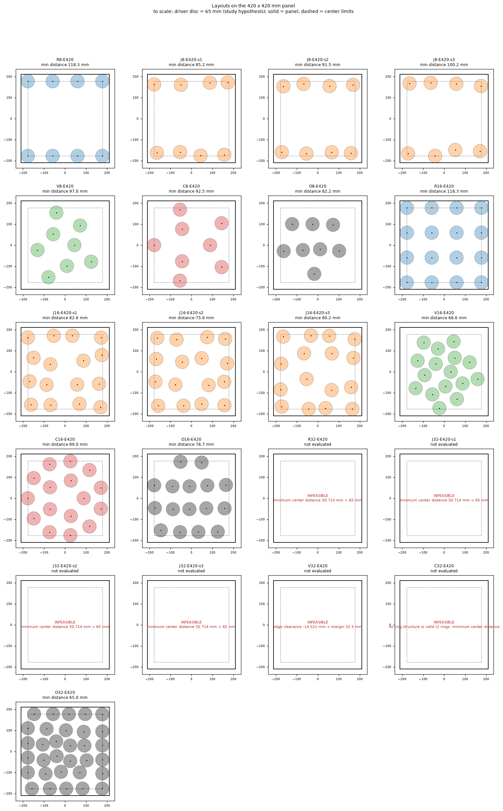

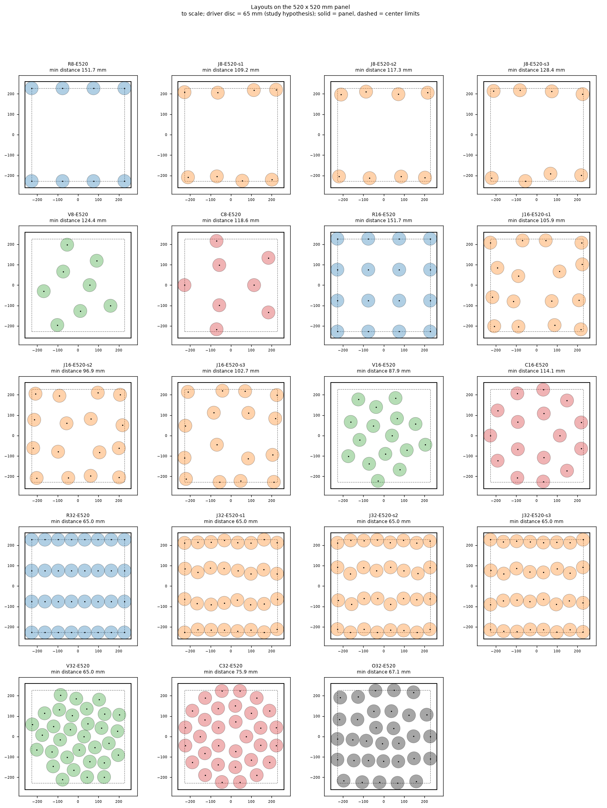

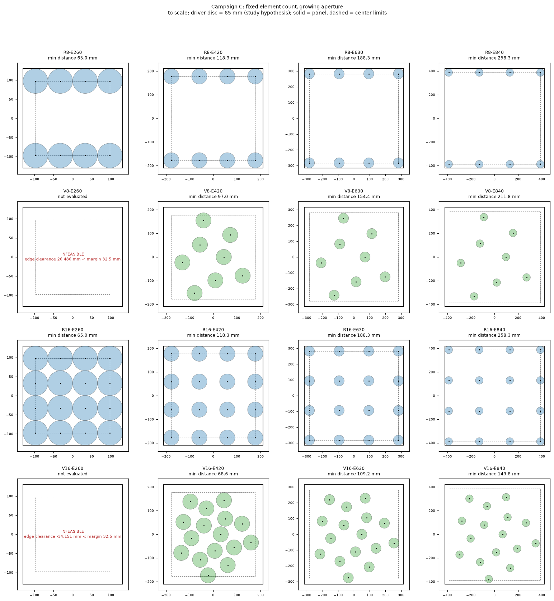

## Results

Selectivity = share of ROI energy within +/-10 deg. "Validation" means averaged over the five held-out foci. Strongest lobe and pedestal are in dB relative to the focus (validation, 2-4 kHz).

### Campaign A: same N, same panel (420 mm)

| Layout | N | Min. distance (mm) | Focus level (dB) | Share +/-10 deg 1.5-3.5 kHz | 2-4 kHz | 1-8 kHz | 2-4 kHz worst focus | 2-4 kHz line p10, worst focus | Contrast to secondary lobes (dB) | Strongest lobe (dB re focus) | Pedestal median (dB re focus) | -3 dB width h / v (mm) |
|---|---|---|---|---|---|---|---|---|---|---|---|---|
| R8-E420 | 8 | 118.3 | 17.80 | 0.162 | 0.129 | 0.098 | 0.125 | 0.056 | 1.4 | -1.4 | -14.3 | 256 / 174 |
| J8-E420-s1 | 8 | 85.2 | 17.82 | 0.165 | 0.137 | 0.101 | 0.131 | 0.071 | 1.4 | -1.5 | -13.1 | 267 / 185 |
| J8-E420-s2 | 8 | 91.5 | 17.83 | 0.173 | 0.144 | 0.103 | 0.142 | 0.072 | 1.4 | -1.4 | -13.5 | 270 / 192 |
| J8-E420-s3 | 8 | 100.2 | 17.83 | 0.172 | 0.140 | 0.102 | 0.137 | 0.067 | 1.5 | -1.5 | -13.5 | 266 / 189 |
| V8-E420 | 8 | 97.0 | 17.93 | 0.233 | 0.235 | 0.138 | 0.227 | 0.162 | 3.1 | -5.5 | -12.6 | 429 / 333 |
| C8-E420 | 8 | 92.5 | 17.91 | 0.202 | 0.184 | 0.120 | 0.167 | 0.135 | 3.7 | -3.7 | -11.4 | 319 / 303 |
| O8-E420 | 8 | 82.2 | 17.94 | 0.255 | 0.288 | 0.149 | 0.274 | 0.222 | 3.1 | -5.2 | -14.1 | 403 / 409 |
| Ow8-E420 | 8 | 87.5 | 17.95 | 0.238 | 0.247 | 0.142 | 0.238 | 0.181 | 3.4 | -5.0 | -12.5 | 396 / 383 |
| R16-E420 | 16 | 118.3 | 20.87 | 0.416 | 0.383 | 0.194 | 0.361 | 0.180 | 4.2 | -4.2 | -20.0 | 254 / 241 |
| J16-E420-s1 | 16 | 82.6 | 20.89 | 0.358 | 0.360 | 0.197 | 0.341 | 0.230 | 6.8 | -7.4 | -16.1 | 262 / 260 |
| J16-E420-s2 | 16 | 75.6 | 20.89 | 0.372 | 0.378 | 0.202 | 0.363 | 0.251 | 6.4 | -6.9 | -16.6 | 271 / 268 |
| J16-E420-s3 | 16 | 80.2 | 20.88 | 0.356 | 0.336 | 0.194 | 0.315 | 0.196 | 5.3 | -5.3 | -15.9 | 268 / 243 |
| V16-E420 | 16 | 68.6 | 20.94 | 0.309 | 0.393 | 0.224 | 0.374 | 0.286 | 3.5 | -12.3 | -17.5 | 403 / 350 |
| C16-E420 | 16 | 89.0 | 20.91 | 0.377 | 0.418 | 0.212 | 0.405 | 0.325 | 5.8 | -8.3 | -16.8 | 308 / 293 |
| O16-E420 | 16 | 78.7 | 20.91 | 0.403 | 0.483 | 0.222 | 0.456 | 0.390 | 5.4 | -11.2 | -19.4 | 316 / 301 |
| Ow16-E420 | 16 | 65.1 | 20.91 | 0.414 | 0.440 | 0.217 | 0.426 | 0.319 | 5.9 | -8.5 | -19.0 | 302 / 287 |
| O32-E420 | 32 | 65.0 | 23.91 | 0.469 | 0.582 | 0.326 | 0.550 | 0.448 | 6.6 | -12.0 | -24.3 | 282 / 277 |

### Campaign B: common envelope of 520 mm

| Layout | N | Min. distance (mm) | Focus level (dB) | Share +/-10 deg 1.5-3.5 kHz | 2-4 kHz | 1-8 kHz | 2-4 kHz worst focus | 2-4 kHz line p10, worst focus | Contrast to secondary lobes (dB) | Strongest lobe (dB re focus) | Pedestal median (dB re focus) | -3 dB width h / v (mm) |
|---|---|---|---|---|---|---|---|---|---|---|---|---|
| R8-E520 | 8 | 151.7 | 17.68 | 0.115 | 0.084 | 0.078 | 0.074 | 0.047 | 1.5 | -1.5 | -11.6 | 201 / 138 |
| J8-E520-s1 | 8 | 109.2 | 17.71 | 0.123 | 0.093 | 0.082 | 0.084 | 0.049 | 1.5 | -1.5 | -11.5 | 210 / 148 |
| J8-E520-s2 | 8 | 117.3 | 17.73 | 0.128 | 0.096 | 0.084 | 0.087 | 0.048 | 1.5 | -1.5 | -12.1 | 213 / 153 |
| J8-E520-s3 | 8 | 128.4 | 17.72 | 0.124 | 0.092 | 0.082 | 0.083 | 0.048 | 1.5 | -1.6 | -11.3 | 209 / 151 |
| V8-E520 | 8 | 124.4 | 17.89 | 0.217 | 0.184 | 0.118 | 0.169 | 0.115 | 4.3 | -4.6 | -11.2 | 334 / 260 |
| C8-E520 | 8 | 118.6 | 17.85 | 0.173 | 0.144 | 0.097 | 0.132 | 0.082 | 3.6 | -3.6 | -10.5 | 249 / 236 |
| R16-E520 | 16 | 151.7 | 20.79 | 0.329 | 0.236 | 0.153 | 0.205 | 0.093 | 4.2 | -4.3 | -17.9 | 199 / 188 |
| J16-E520-s1 | 16 | 105.9 | 20.81 | 0.326 | 0.261 | 0.161 | 0.240 | 0.122 | 6.2 | -6.5 | -15.1 | 205 / 204 |
| J16-E520-s2 | 16 | 96.9 | 20.82 | 0.343 | 0.275 | 0.167 | 0.255 | 0.132 | 6.0 | -6.2 | -15.5 | 213 / 211 |
| J16-E520-s3 | 16 | 102.7 | 20.80 | 0.304 | 0.239 | 0.157 | 0.221 | 0.112 | 5.5 | -5.5 | -14.9 | 210 / 189 |
| V16-E520 | 16 | 87.9 | 20.90 | 0.382 | 0.400 | 0.210 | 0.385 | 0.289 | 5.7 | -9.0 | -17.0 | 314 / 273 |
| C16-E520 | 16 | 114.1 | 20.85 | 0.375 | 0.314 | 0.180 | 0.297 | 0.148 | 6.5 | -6.5 | -16.2 | 241 / 229 |
| R32-E520 | 32 | 65.0 | 23.82 | 0.525 | 0.500 | 0.291 | 0.480 | 0.271 | 4.4 | -4.4 | -24.6 | 229 / 188 |
| J32-E520-s1 | 32 | 65.0 | 23.83 | 0.515 | 0.512 | 0.292 | 0.488 | 0.303 | 5.3 | -5.4 | -22.8 | 229 / 195 |
| J32-E520-s2 | 32 | 65.0 | 23.83 | 0.522 | 0.511 | 0.291 | 0.495 | 0.296 | 5.3 | -5.4 | -23.1 | 229 / 195 |
| J32-E520-s3 | 32 | 65.0 | 23.83 | 0.526 | 0.518 | 0.292 | 0.500 | 0.297 | 5.1 | -5.2 | -23.7 | 229 / 195 |
| V32-E520 | 32 | 65.0 | 23.91 | 0.468 | 0.577 | 0.319 | 0.553 | 0.451 | 6.5 | -16.3 | -21.2 | 284 / 273 |
| C32-E520 | 32 | 75.9 | 23.88 | 0.503 | 0.594 | 0.312 | 0.568 | 0.490 | 8.1 | -14.1 | -21.9 | 257 / 244 |
| O32-E520 | 32 | 67.1 | 23.86 | 0.566 | 0.662 | 0.317 | 0.622 | 0.544 | 8.7 | -13.8 | -24.4 | 246 / 231 |

### Effect of the number of elements (campaigns A and B)

| Family (2-4 kHz, validation foci; J: mean of 3 seeds) | 8 elements | 16 elements | 32 elements |
|---|---|---|---|
| R on 420 mm | 0.129 | 0.383 | infeasible |
| J on 420 mm | 0.140 | 0.358 | infeasible |
| V on 420 mm | 0.235 | 0.393 | infeasible |
| C on 420 mm | 0.184 | 0.418 | infeasible |
| O on 420 mm | 0.288 | 0.483 | 0.582 |
| R on 520 mm | 0.084 | 0.236 | 0.500 |
| J on 520 mm | 0.093 | 0.258 | 0.514 |
| V on 520 mm | 0.184 | 0.400 | 0.577 |
| C on 520 mm | 0.144 | 0.314 | 0.594 |
| O on 520 mm | - | - | 0.662 |

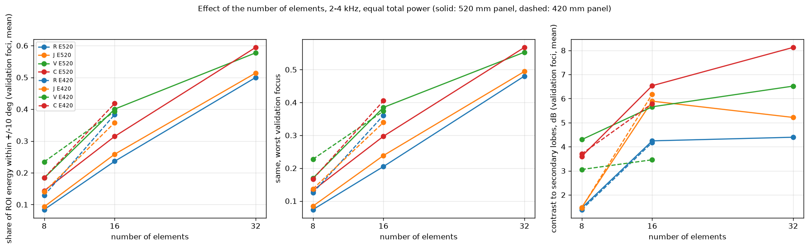

### Campaign C: effect of the aperture at fixed element count (regular and spiral)

| Layout (2-4 kHz, validation foci) | 260 mm | 420 mm | 520 mm | 630 mm | 840 mm |
|---|---|---|---|---|---|
| R8 | 0.197 | 0.129 | 0.084 | 0.063 | 0.051 |
| V8 | infeasible | 0.235 | 0.184 | 0.138 | 0.083 |
| R16 | 0.326 | 0.383 | 0.236 | 0.146 | 0.080 |
| V16 | infeasible | 0.393 | 0.400 | 0.310 | 0.171 |

| Layout | N | Min. distance (mm) | Focus level (dB) | Share +/-10 deg 1.5-3.5 kHz | 2-4 kHz | 1-8 kHz | 2-4 kHz worst focus | 2-4 kHz line p10, worst focus | Contrast to secondary lobes (dB) | Strongest lobe (dB re focus) | Pedestal median (dB re focus) | -3 dB width h / v (mm) |
|---|---|---|---|---|---|---|---|---|---|---|---|---|
| R8-E260 | 8 | 65.0 | 17.94 | 0.195 | 0.197 | 0.140 | 0.185 | 0.177 | 1.4 | -1.4 | -14.8 | 466 / 319 |
| R8-E420 | 8 | 118.3 | 17.80 | 0.162 | 0.129 | 0.098 | 0.125 | 0.056 | 1.4 | -1.4 | -14.3 | 256 / 174 |
| R8-E630 | 8 | 188.3 | 17.51 | 0.084 | 0.063 | 0.063 | 0.056 | 0.045 | 1.7 | -1.5 | -9.5 | 164 / 107 |
| R8-E840 | 8 | 258.3 | 17.12 | 0.058 | 0.051 | 0.051 | 0.044 | 0.040 | 1.0 | -0.8 | -8.5 | 122 / 83 |
| V8-E420 | 8 | 97.0 | 17.93 | 0.233 | 0.235 | 0.138 | 0.227 | 0.162 | 3.1 | -5.5 | -12.6 | 429 / 333 |
| V8-E630 | 8 | 154.4 | 17.83 | 0.176 | 0.138 | 0.097 | 0.126 | 0.078 | 4.3 | -4.6 | -10.2 | 269 / 211 |
| V8-E840 | 8 | 211.8 | 17.70 | 0.114 | 0.083 | 0.071 | 0.076 | 0.044 | 3.9 | -4.5 | -9.2 | 197 / 156 |
| R16-E260 | 16 | 65.0 | 20.97 | 0.235 | 0.326 | 0.227 | 0.304 | 0.209 | 2.5 | -13.6 | -16.4 | 465 / 440 |
| R16-E420 | 16 | 118.3 | 20.87 | 0.416 | 0.383 | 0.194 | 0.361 | 0.180 | 4.2 | -4.2 | -20.0 | 254 / 241 |
| R16-E630 | 16 | 188.3 | 20.67 | 0.222 | 0.146 | 0.118 | 0.127 | 0.072 | 4.5 | -4.5 | -16.3 | 162 / 155 |
| R16-E840 | 16 | 258.3 | 20.40 | 0.119 | 0.080 | 0.079 | 0.072 | 0.048 | 4.1 | -4.1 | -13.7 | 119 / 113 |
| V16-E420 | 16 | 68.6 | 20.94 | 0.309 | 0.393 | 0.224 | 0.374 | 0.286 | 3.5 | -12.3 | -17.5 | 403 / 350 |
| V16-E630 | 16 | 109.2 | 20.85 | 0.370 | 0.310 | 0.181 | 0.287 | 0.151 | 7.1 | -7.4 | -15.5 | 252 / 222 |
| V16-E840 | 16 | 149.8 | 20.71 | 0.245 | 0.171 | 0.130 | 0.154 | 0.085 | 6.7 | -6.9 | -13.3 | 185 / 163 |

### Regular versus irregular

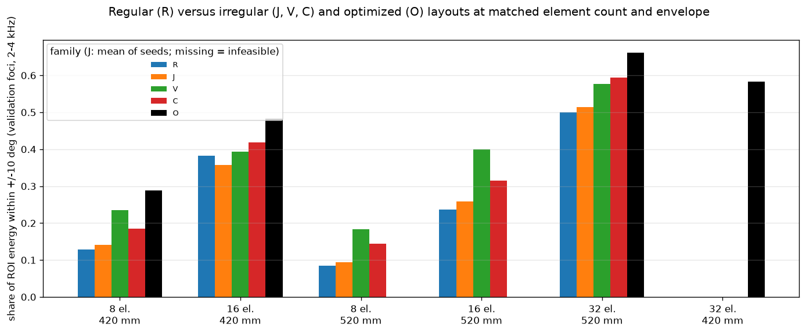

### Spatial distribution of the lobes (angular maps on the shell at the focus distance)

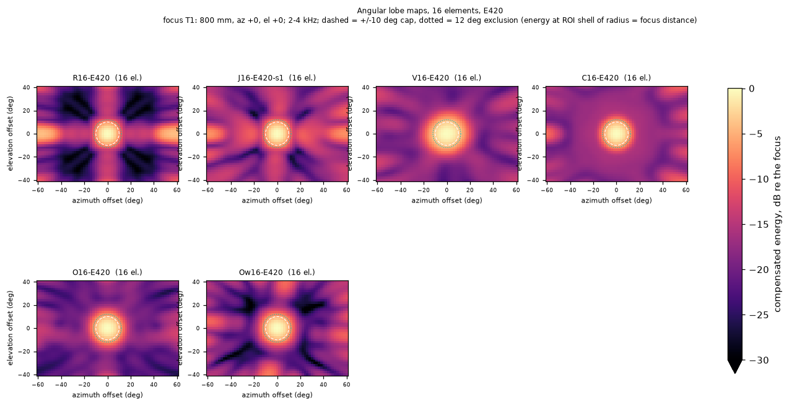

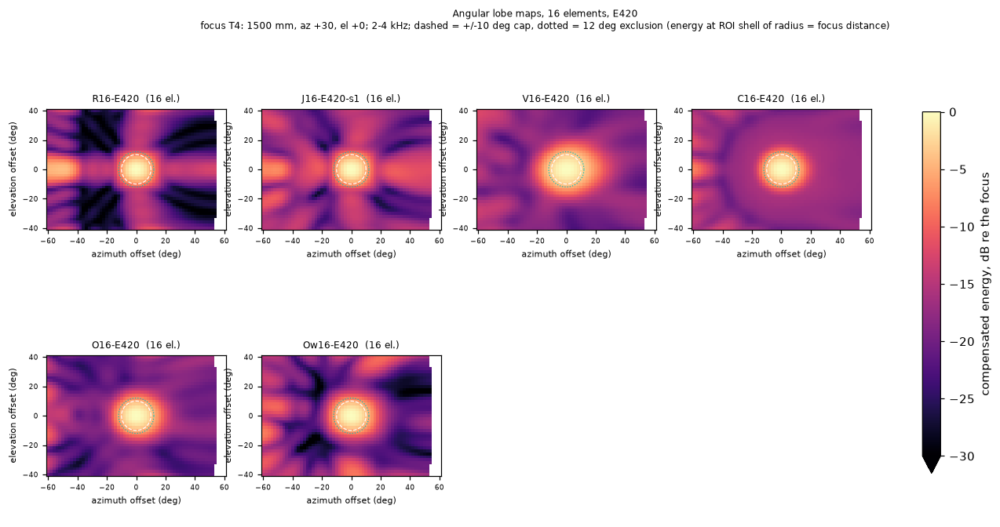

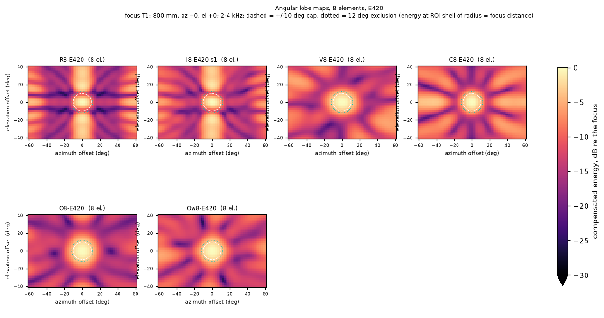

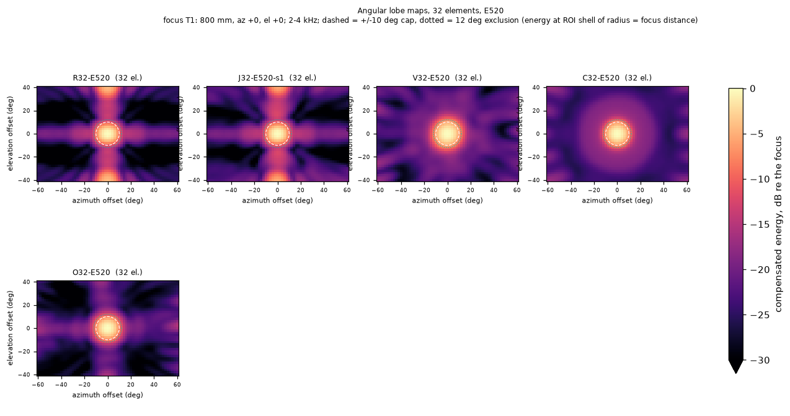

### Orthogonal cuts through the focus (0, 0, 800) mm

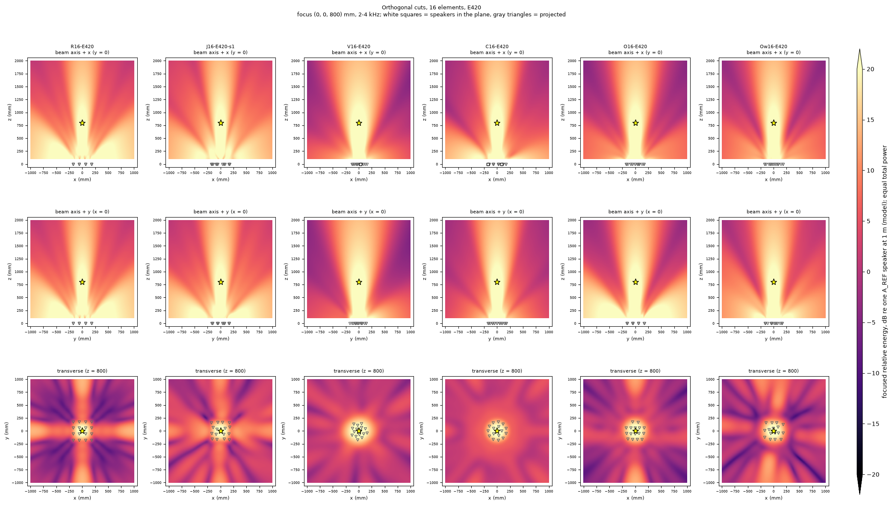

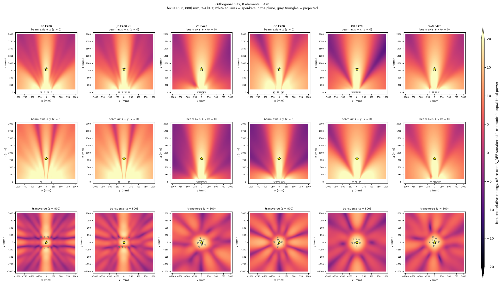

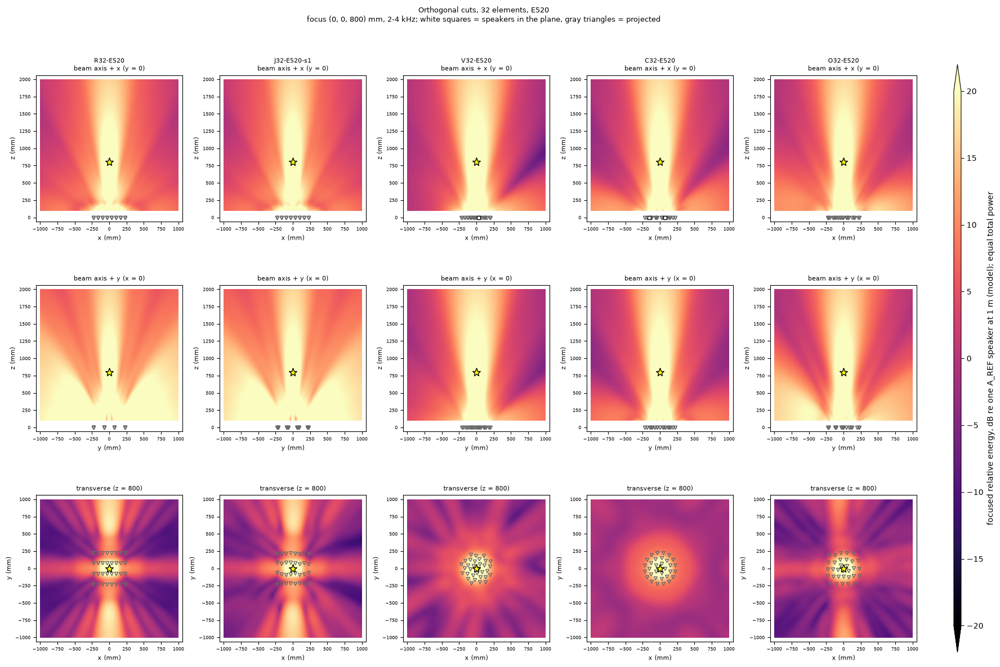

### Campaign D: optimization

Restarts (every restart starts from a different valid layout):

| N | Panel | Training band | Restarts run | Best-J range | Best restart | Objective evaluations | Seconds | Evaluator memory (MB) | Initial layouts that were infeasible |
|---|---|---|---|---|---|---|---|---|---|
| 8 | 420 mm | 2-4 kHz | 5 | 2.2021 - 2.2090 | rand1 | 47275 | 141 | 1.7 | - |
| 16 | 420 mm | 2-4 kHz | 5 | 1.6420 - 1.6746 | J1 | 41406 | 125 | 1.7 | - |
| 32 | 420 mm | 2-4 kHz | 2 | 1.3824 - 1.4095 | rand1 | 6090 | 19 | 1.7 | V (edge clearance -14.521 mm < ...); C (no ring structure is valid (...); J (minimum center distance 50.7...) |
| 32 | 520 mm | 2-4 kHz | 5 | 1.0910 - 1.1353 | C0 | 35977 | 113 | 1.7 | - |
| 8 | 420 mm | 1-8 kHz | 5 | 2.4870 - 2.4896 | C0 | 44947 | 340 | 4.6 | - |
| 16 | 420 mm | 1-8 kHz | 5 | 2.2613 - 2.2647 | rand1 | 37694 | 290 | 4.6 | - |

Optimized layouts against the best non-optimized layout of the same N and panel:

| Optimized layout | Train foci 2-4 kHz | Validation foci 2-4 kHz | Validation 1.5-3.5 kHz | Validation 1-8 kHz | Best non-optimized, same N and panel (2-4 / 1.5-3.5 / 1-8 kHz) | Validation gain, 2-4 kHz |
|---|---|---|---|---|---|---|
| O8-E420 | 0.290 | 0.288 | 0.255 | 0.149 | V8-E420: 0.235 / 0.233 / 0.138 | +23 % |
| Ow8-E420 | 0.248 | 0.247 | 0.238 | 0.142 | V8-E420: 0.235 / 0.233 / 0.138 | +5 % |
| O16-E420 | 0.485 | 0.483 | 0.403 | 0.222 | C16-E420: 0.418 / 0.377 / 0.212 | +16 % |
| Ow16-E420 | 0.440 | 0.440 | 0.414 | 0.217 | C16-E420: 0.418 / 0.377 / 0.212 | +5 % |
| O32-E420 | 0.585 | 0.582 | 0.469 | 0.326 | none feasible | - |
| O32-E520 | 0.664 | 0.662 | 0.566 | 0.317 | C32-E520: 0.594 / 0.503 / 0.312 | +11 % |

(For 32 elements on the 420 mm panel there is no feasible non-optimized layout; O32-E420 is compared with the 520 mm layouts in the Pareto analysis.)

Finalists (all Pareto-optimal layouts, the optimized ones, and the best non-optimized layout of each N and panel) are exported to `configs/arrays/optimized/*.json`, readable by every earlier command (`field-cuts`, `broadband-map`, ...).

### Pareto analysis

Four objectives: selectivity (validation foci, mean of the three bands) up, robustness (worst validation focus) up, number of elements down, panel area down. Non-dominated layouts:

| Layout | N | Panel (mm) | Selectivity (share +/-10 deg, validation, mean of 3 bands) | Robustness: worst validation focus | Robustness: worst line percentile |
|---|---|---|---|---|---|
| O8-E420 | 8 | 420x420 | 0.230 | 0.217 | 0.147 |
| R8-E260 | 8 | 260x260 | 0.178 | 0.169 | 0.131 |
| O16-E420 | 16 | 420x420 | 0.369 | 0.348 | 0.243 |
| R16-E260 | 16 | 260x260 | 0.263 | 0.249 | 0.155 |
| O32-E520 | 32 | 520x520 | 0.515 | 0.485 | 0.343 |
| O32-E420 | 32 | 420x420 | 0.459 | 0.436 | 0.295 |

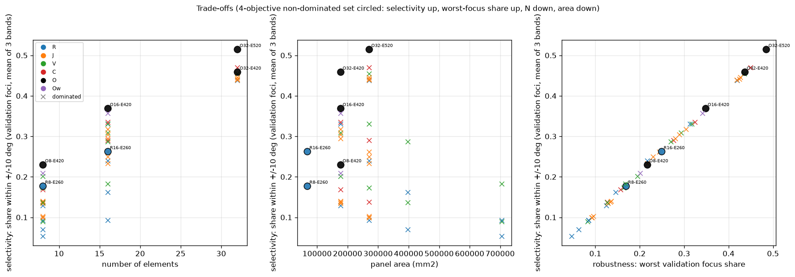

Best alternative per category (no single score is used):

| N | Category | Layout | Panel (mm) | Selectivity | Worst-focus robustness |
|---|---|---|---|---|---|
| 8 | best overall | O8-E420 | 420x420 | 0.230 | 0.217 |
| 8 | best regular (R) | R8-E260 | 260x260 | 0.178 | 0.169 |
| 8 | best non-optimized irregular | V8-E420 | 420x420 | 0.202 | 0.195 |
| 8 | best optimized | O8-E420 | 420x420 | 0.230 | 0.217 |
| 16 | best overall | O16-E420 | 420x420 | 0.369 | 0.348 |
| 16 | best regular (R) | R16-E420 | 420x420 | 0.331 | 0.314 |
| 16 | best non-optimized irregular | C16-E420 | 420x420 | 0.336 | 0.324 |
| 16 | best optimized | O16-E420 | 420x420 | 0.369 | 0.348 |
| 32 | best overall | O32-E520 | 520x520 | 0.515 | 0.485 |
| 32 | best regular (R) | R32-E520 | 520x520 | 0.439 | 0.419 |
| 32 | best non-optimized irregular | C32-E520 | 520x520 | 0.470 | 0.450 |
| 32 | best optimized | O32-E520 | 520x520 | 0.515 | 0.485 |

Sensitivity of the ranking to the angular window (2-4 kHz, validation foci), showing whether the conclusions depend on the 10 degree choice:

| Group | Metric (2-4 kHz, validation) | Ranking |
|---|---|---|
| 8 el., 420 mm | +/-5 deg | O8 > V8 > C8 > J8 > R8 |
| 8 el., 420 mm | +/-10 deg | O8 > V8 > C8 > J8 > R8 |
| 8 el., 420 mm | +/-15 deg | O8 > V8 > C8 > J8 > R8 |
| 8 el., 420 mm | contrast | C8 > O8 > V8 > J8 > R8 |
| 16 el., 420 mm | +/-5 deg | O16 > R16 > C16 > J16 > V16 |
| 16 el., 420 mm | +/-10 deg | O16 > C16 > V16 > R16 > J16 |
| 16 el., 420 mm | +/-15 deg | O16 > V16 > C16 > J16 > R16 |
| 16 el., 420 mm | contrast | J16 > C16 > O16 > R16 > V16 |
| 32 el., 520 mm | +/-5 deg | O32 > C32 > J32 > R32 > V32 |
| 32 el., 520 mm | +/-10 deg | O32 > C32 > V32 > J32 > R32 |
| 32 el., 520 mm | +/-15 deg | O32 > V32 > C32 > J32 > R32 |
| 32 el., 520 mm | contrast | O32 > C32 > V32 > J32 > R32 |

## Answers

**1. Do non-periodic arrays reduce the grating lobes?** Yes, the strongest secondary lobe falls by 4 to 9 dB, except for small perturbations of a grid. At 16 elements on 420 mm, the strongest lobe is only 4.2 dB below the focus for the regular grid (the "cross" of grating lobes is visible in the transverse cuts) and 12.3 / 8.3 / 11.2 dB below for spiral / rings / optimized. At 8 elements: 1.4 dB (regular) against 5.5 (spiral) and 5.2 (optimized). A perturbed grid with a shift of 25 % of the pitch is not enough at 8 elements (1.4 dB, as the regular one) and only partly at 16 (6.9 dB). With 32 elements on 520 mm: 4.4 dB regular, 16.3 spiral, 14.1 rings, 13.8 optimized.

**2. Does the unwanted energy really decrease or only get redistributed?** Both. The energy outside the 10 degree cap decreases (share inside: 16 elements, 420 mm: 0.38 regular, 0.39 spiral, 0.42 rings, 0.48 optimized; 8 elements: 0.13, 0.24, 0.18, 0.29), so part of the gratings' energy is brought back into the desired region. But the diffuse pedestal rises where the layout is merely irregular: -20.0 dB (regular), -17.5 (spiral) and -16.8 (rings) at 16 elements, 2.5 to 3.2 dB of redistribution into the background; the optimizer, which penalizes the energy outside the cap, keeps the pedestal at -19.4 dB (-24.4 against -24.6 for 32 elements). Irregularity alone trades lobes for pedestal; optimization or a good family also reduces the total.

**3. What is gained from 8 to 16 to 32 elements at fixed aperture?** Much, and more than from any other change at equal total power. On the common 520 mm panel (2-4 kHz, validation) the selectivity goes from 0.08 to 0.24 to 0.50 for the regular grid and from 0.18 to 0.40 to 0.58 for the spiral (x2.2 then x1.4); on 420 mm from 0.13 to 0.38 (regular) and 0.24 to 0.39 (spiral), 0.29 to 0.48 (optimized). The focus level adds 3 dB per doubling. 32 elements need the drivers almost touching (65.0 mm at 420 mm, optimized): the benefit is real but mechanically at the limit.

**4. What is gained by enlarging the aperture without adding elements?** Not monotonic: with the element count fixed the spacing grows with the aperture, and gratings appear. For the regular 16 elements the share is 0.33 (260 mm), 0.38 (420), 0.24 (520), 0.15 (630), 0.08 (840); for 8 elements it falls from 0.20 at 260 mm to 0.05 at 840 mm. The spiral keeps its value up to 520 mm (0.39 to 0.40) and then falls (0.31, 0.17): a non-periodic layout delays the penalty of a large aperture, it does not remove it. In this study, an aperture larger than about 400 to 500 mm only pays off together with more elements.

**5. Does an optimized layout beat a regular grid on the validation foci?** Yes, clearly, and it generalizes to the held-out positions: validation 0.483 against train 0.485 (16 elements), 0.288 against 0.290 (8), 0.582 against 0.585 (32). It beats the regular grid by 26 % (16 elements, 420 mm), 123 % (8 elements) and 32 % (32 elements, 520 mm) and the best non-optimized layout of the same N by 16 %, 23 % and 11 %. **But it does not generalize in frequency:** trained on 2-4 kHz, at 16 elements it is slightly worse than the regular grid on 1.5-3.5 kHz (0.403 against 0.416; grating-free there) and equal to the spiral on 1-8 kHz (0.222 against 0.224). The layout trained on 1-8 kHz (Ow) did not improve 1-8 kHz (0.217) and lost 2-4 kHz (0.440): with 65 mm drivers no layout of 16 elements avoids grating-type lobes at 5 to 8 kHz.

**6. What is the trade-off between selectivity, robustness and physical size?** See the Pareto table: the non-dominated set is small. At the top: O32 (0.46 on 420 mm, 0.52 on 520 mm). Next O16-E420 (0.37, 16 channels) and O8-E420 (0.23). At the small-size end R8-E260 and R16-E260 dominate on area. The robustness over foci and over spectral lines follows selectivity closely (all layouts degrade together at large angles). The spiral and rings (analytic, no optimization) are within about 9 to 12 % of the optimized selectivity at 8 and 16 elements. From O8 to O16 to O32 the selectivity (mean of three bands) goes 0.23, 0.37, 0.46, with 3 dB more focus level per step, at the cost of 8 or 16 more channels and a denser panel.

**7. Is there a particularly promising layout for a first prototype?** For the existing 8-channel interface: 8 drivers on the 420 mm panel in the optimized layout O8-E420 (validation 0.288, contrast 3.1 dB; the Vogel spiral V8-E420 is a simple, parametric alternative with 0.235) rather than the 2 x 4 grid (0.129). Their absolute selectivity is modest (strongest lobe about 5 dB below the focus): treat it as a platform to validate the model, not as a sharp focus. If 16 channels become available (hardware beyond this mission), the ring layout C16-E420 (0.418, analytic) or O16-E420 (0.483) on the same panel is the natural next step. 32 drivers on 420 mm are at the mechanical limit.

**8. Which results remain sensitive to the point-source, free-field assumptions?** (a) *Driver directivity*: a 65 mm driver has `ka` about 2.4 at 4 kHz, so real drivers attenuate the lobes at large angles; the gain of irregular layouts over regular ones near the axis should remain, but the grating lobes at +/-40 deg and beyond, which dominate F10 for the large regular grids, would be weaker than modeled and the comparison would favor sparse layouts more than shown. (b) *Room*: reflections add a pedestal that would hide the pedestal differences found here (point 2), so only the lobe-level results (point 1) are expected to survive. (c) *Driver size*: the 65 mm hypothesis fixes feasibility (32 elements) and the minimum spacing. (d) *Definitions*: the optimized layout ranks first for every window (5, 10, 15 degrees) and every N, and the regular grid is last or next to last at 8 and 32 elements, but the order of the other families depends on the window: at 16 elements the regular grid is second at 5 degrees (its main lobe is the narrowest) and fourth at 10 degrees (see the sensitivity table). Absolute shares depend on the 10 degree tube and on the ROI. (e) *Spectral band*: the optimized layouts are specific to the training band. (f) *Equal amplitudes and calibration*: not modeled. These points are not simulated here.

## Limitations

- Ideal point sources in a free field; no driver size or directivity, baffle, diffraction, room or channel mismatch.
- The 65 mm diameter is a hypothesis; results scale with the real size.
- The optimizer is a stochastic local search with restarts: it finds good layouts, not a proven global optimum. The five restarts of the 8-element case ended within 0.4 % of each other (many near-equivalent layouts); for 32 elements the starting layout mattered more.
- Selectivity is a share of ROI energy in a +/-10 degree tube, not total radiated power; the ROI is limited to +/-60 x +/-40 degrees and 0.8 to 1.2 of the range.
- Regions touching the ROI limits are lower bounds (all depths); no volumetric focal measure is claimed.
- Ten foci (five per set), three bands, one panel shape; no 3-D optimization of the panel plane or of non-planar arrays.
- The spiral and rings use their documented defaults (disc inscribed in the center square, proportional counts); other parameters might perform differently.

## Recommendations

- Choose the number of elements before the layout: doubling N is worth more than any redistribution at equal total power.
- Do not enlarge the aperture at fixed N beyond about 400 to 500 mm with 65 mm drivers; a non-periodic layout postpones, not removes, the penalty.
- Use a spiral or ring layout as a robust analytic first choice; use the optimizer when a specific band and region are known, and validate it on other bands.
- Before building: measure the driver size and directivity, replace the 65 mm hypothesis, repeat the campaign with driver directivity and, if possible, with a measured room.
