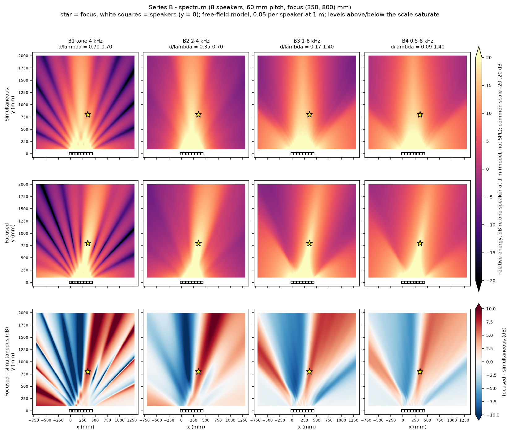
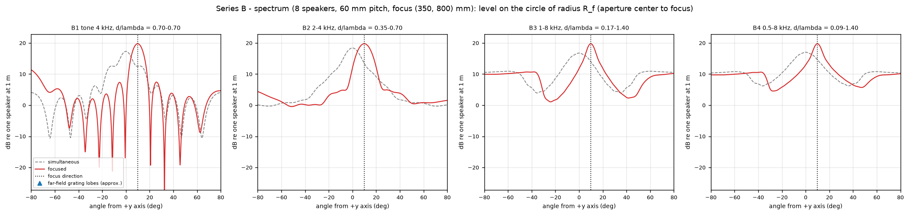
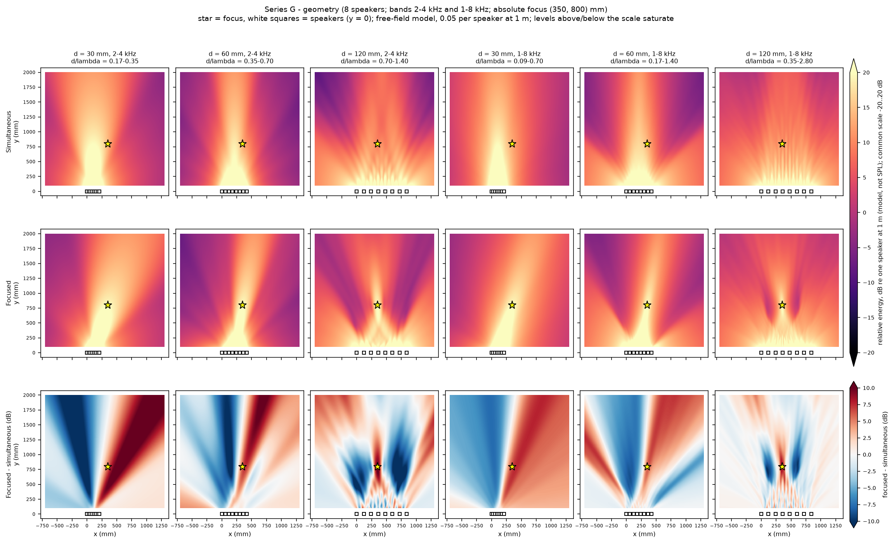
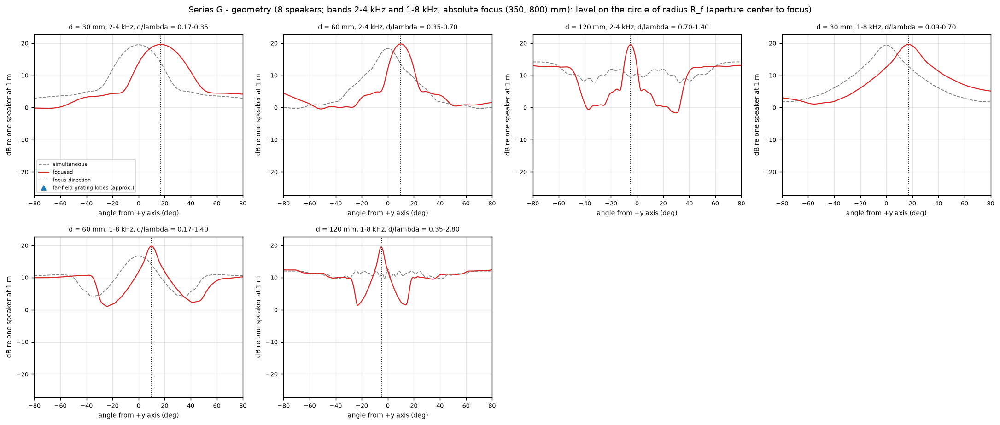
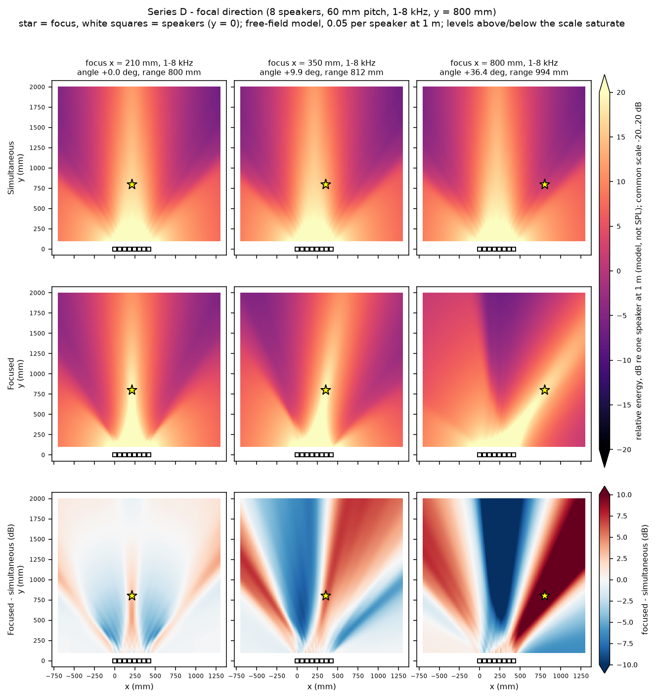
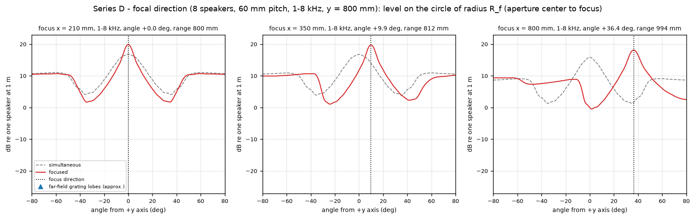
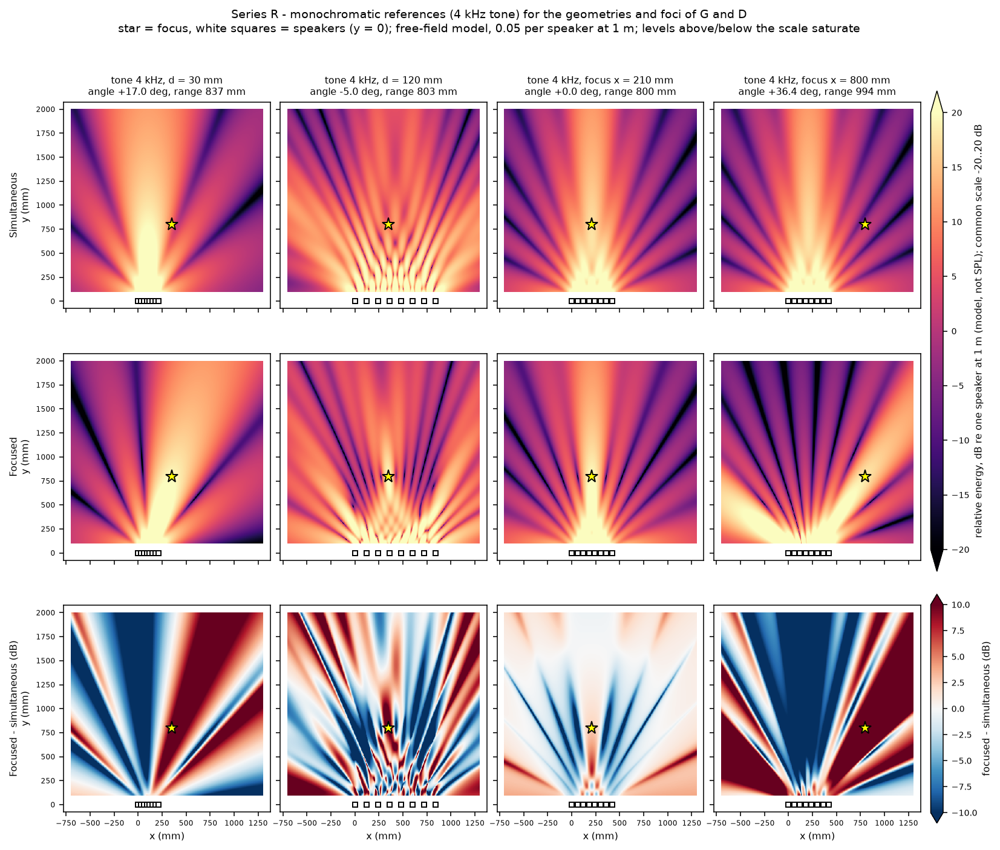
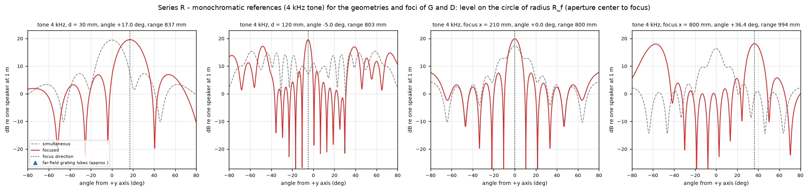

# Broadband acoustic field study

What changes when a pure tone is replaced by a broadband signal: spatial distribution of the time-averaged acoustic energy of the 8-speaker line array, with the real focusing delays of `docs/static-focusing.md`. Free-field, ideal point-source model: **predictions in dB relative to one speaker heard at 1 m, not measurements and not dB SPL.**

## Method

**Signal.** Every speaker emits the same stationary signal, delayed by its own focusing delay `e_i` (a true time delay, so the same physical delay acts on every frequency; no per-frequency phase or amplitude tuning, no adaptive filtering). The power spectrum is represented by lines `(f_k, w_k)` with `sum w_k = 1`.

**Energy combination.** Components of different frequency are orthogonal over a long window, so mean-square pressures add, phasors do not:

```
p_rms^2(x) = (1/2) sum_k w_k |P_k(x)|^2        P_k = complex_field at f_k with amplitude A (field.py)
level      = 10 log10( p_rms^2 / (A^2 / 2) )   = 20 log10( sqrt(sum_k w_k |P_k|^2) / A )
```

This is the **time-averaged energy map**. It is not an instantaneous pressure map: the peak pressure and the waveform at a point depend on the phases between lines, which the model does not average (and which differ between a tone, a multisine and a noise realization). For a single line the formula is the monochromatic map of `docs/field-map.md`, bit for bit (tested).

**Normalization.** The weights sum to 1, so each speaker emits the same total power `A^2 / 2` (`A = 0.05` at 1 m) whatever the spectrum. Tone and bands are therefore directly comparable, and a single source produces the same energy for any spectrum (tested).

**Spectral quadrature.** A band is divided into bins of target width `--df` (default 25 Hz); each line sits at the middle of its bin and carries the exact integral of the spectral density over the bin. Uniform density (default): equal weights; `--distribution pink`: density proportional to 1/f (weight `ln(f_hi/f_lo)`, geometric mid-frequency). `f_min == f_max` is a tone. Only the maps for one frequency at a time are held in memory (`FieldGeometry` keeps distances only), so a 300-line scenario on a 401 x 381 grid takes tens of seconds.

**Convergence.** Maximum change of the maps (dB) against a 6.25 Hz reference, on a 4x coarser map (101 x 96 points):

| Scenario | Line spacing (Hz) | Lines | Max |change| of focused map (dB) | Max |change| of difference map (dB) |
|---|---|---|---|---|
| B/B2 | 200 | 10 | 0.0889 | 0.1083 |
| B/B2 | 100 | 20 | 0.0208 | 0.0254 |
| B/B2 | 50 | 40 | 0.0051 | 0.0062 |
| B/B2 | 25 | 80 | 0.0012 | 0.0015 |
| B/B2 | 12.5 | 160 | 0.0002 | 0.0003 |
| B/B3 | 200 | 35 | 0.0757 | 0.0530 |
| B/B3 | 100 | 70 | 0.0187 | 0.0131 |
| B/B3 | 50 | 140 | 0.0046 | 0.0032 |
| B/B3 | 25 | 280 | 0.0011 | 0.0008 |
| B/B3 | 12.5 | 560 | 0.0002 | 0.0002 |
| B/B4 | 200 | 38 | 0.0874 | 0.0682 |
| B/B4 | 100 | 75 | 0.0220 | 0.0172 |
| B/B4 | 50 | 150 | 0.0054 | 0.0042 |
| B/B4 | 25 | 300 | 0.0013 | 0.0010 |
| B/B4 | 12.5 | 600 | 0.0003 | 0.0002 |

The error falls by a factor of about 4 each time the spacing halves (second order). At the default 25 Hz it is at most 0.0013 dB (focused map) and 0.0015 dB (difference map). A pair of speakers separated by at most the 420 mm aperture produces spectral ripple of period at least `c / 0.42 m` = 820 Hz, so 25 Hz is far finer than the structure to be resolved.

## Scenarios

Series B (spectrum), G (geometry, bands B2 and B3), D (direction, band B3), plus R: 4 kHz tone references for the geometries and foci of G and D (the monochromatic baseline of Mission 04). Region x -700..1300, y 100..2000, z = 0, 401 x 381 points; c = 343 m/s; gain 0.05; the foci of G keep the absolute position (350, 800) mm, so their direction relative to each aperture center changes (+17.0, +9.9, -5.0 degrees), as in Mission 04.

| Scenario | Lines | lambda range (mm) | d/lambda range | Focus angle (deg) / range (mm) |
|---|---|---|---|---|
| B/B1 | 1 | 85.8 to 85.8 | 0.70 to 0.70 | +9.9 / 812 |
| B/B2 | 80 | 85.8 to 171.5 | 0.35 to 0.70 | +9.9 / 812 |
| B/B3 | 280 | 42.9 to 343.0 | 0.17 to 1.40 | +9.9 / 812 |
| B/B4 | 300 | 42.9 to 686.0 | 0.09 to 1.40 | +9.9 / 812 |
| G/d030-B2 | 80 | 85.8 to 171.5 | 0.17 to 0.35 | +17.0 / 837 |
| G/d120-B2 | 80 | 85.8 to 171.5 | 0.70 to 1.40 | -5.0 / 803 |
| G/d030-B3 | 280 | 42.9 to 343.0 | 0.09 to 0.70 | +17.0 / 837 |
| G/d120-B3 | 280 | 42.9 to 343.0 | 0.35 to 2.80 | -5.0 / 803 |
| D/x210 | 280 | 42.9 to 343.0 | 0.17 to 1.40 | +0.0 / 800 |
| D/x800 | 280 | 42.9 to 343.0 | 0.17 to 1.40 | +36.4 / 994 |
| R/d030 | 1 | 85.8 to 85.8 | 0.35 to 0.35 | +17.0 / 837 |
| R/d120 | 1 | 85.8 to 85.8 | 1.40 to 1.40 | -5.0 / 803 |
| R/x210 | 1 | 85.8 to 85.8 | 0.70 to 0.70 | +0.0 / 800 |
| R/x800 | 1 | 85.8 to 85.8 | 0.70 to 0.70 | +36.4 / 994 |

Reproduction:

```bash
.venv/bin/bean-lab broadband-campaign --outdir results/broadband --convergence   # all series, about 3 minutes
.venv/bin/bean-lab broadband-campaign --series B --outdir results/broadband      # one series
.venv/bin/bean-lab broadband-map --array configs/arrays/line-8-60mm.json --target 350 800 0 \
    --fmin 1000 --fmax 8000 --outdir /tmp/b3            # a single scenario (B3)
```

`results/` is git-ignored (per-scenario PNGs and `data.npz` with the energy maps, arcs and per-line statistics). Committed: plates and arc plots (`docs/images/broadband/`), indicators and convergence (`docs/data/broadband-*`). Color scales are common to every map of every plate: -20..20 dB for the two energy rows, +/-10 dB for the difference, with arrows on the colorbar where data are clipped by the display. Display options change no data (tested). The `--vmax 20` scale saturates the near field; the data are stored unclipped.

## Plates

Series B, spectrum (B1 tone 4 kHz, B2 2-4 kHz, B3 1-8 kHz, B4 0.5-8 kHz):





Series G, geometry (columns: 30, 60, 120 mm for the 2-4 kHz band, then for the 1-8 kHz band):





Series D, focal direction (1-8 kHz, 60 mm; the central column is B3):





Series R, 4 kHz tone references:





## Indicators

All levels in dB re one speaker at 1 m (energy). Distance effects are separated from directivity in three ways: (1) the **arc** at constant radius `R_f` (aperture center to focus) removes the 1/r trend; (2) the **band** analysis repeats the arc on 21 radii from 0.75 `R_f` to 1.25 `R_f`, each excluding its own main lobe, with levels compensated by `20 log10(r / R_f)`; (3) the **region statistics** use the same compensated levels inside the band.

- *Main lobe*: the lobe of the pattern that contains the intended focus direction, bounded by the first minima. Using the direction of the focus (not the global peak) keeps the definition meaningful when a grating lobe is as strong as the main lobe.
- *Contrast*: lobe peak minus highest sidelobe (arc); focus level minus highest compensated sidelobe in the band (band contrast).
- *-3 dB width*: **reported only when the main lobe is bounded by minima inside the arc and exceeds the highest sidelobe by at least 3 dB.** Otherwise `n/d`. A broadband pattern can have a narrow top on a wide pedestal; its -3 dB width then says little (see below).
- *Focal-lobe energy share* (+/-5 and +/-10 degrees): fraction of the energy integrated along the arc that lies within that window around the focus direction. This is the selectivity measure that does not depend on counting lobes.
- *Band cells above focus - X dB*: share of the compensated focal band (cells inside the map region) whose level reaches the focus level minus X (3, 6, 10 dB).
- *Focal -3 dB region*: the 4-connected region around the focus, inside the band, whose compensated level is within 3 dB of the focus level: area, radial extent and angular extent.
- *Single-line statistics*: the same arc analysis for every spectral line of the scenario, to compare the broadband result with its own components.

## Results

| Scenario | Focus level (dB) | Gain vs simultaneous (dB) | Highest arc sidelobe (dB @ deg) | Arc contrast (dB) | Band contrast (dB) | -3 dB width (deg) | Focal-lobe energy share +/-5 deg | +/-10 deg | Band cells above focus -6 dB (%) | Focal -3 dB region (cm2) |
|---|---|---|---|---|---|---|---|---|---|---|
| B/B1 | 19.76 | +7.26 | 7.43 @ +25.8 | 12.33 | 11.48 | 9.5 | 0.616 | 0.748 | 8.0 | 544 |
| B/B2 | 19.76 | +6.31 | 4.93 @ +28.9 | 14.83 | 14.52 | 12.7 | 0.555 | 0.803 | 11.0 | 732 |
| B/B3 | 19.76 | +5.81 | 10.71 @ -38.1 | 9.05 | 8.80 | 8.6 | 0.365 | 0.489 | 9.1 | 492 |
| B/B4 | 19.76 | +5.17 | 10.64 @ -37.9 | 9.12 | 8.87 | 9.1 | 0.331 | 0.461 | 10.7 | 524 |
| G/d030-B2 | 19.59 | +5.68 | none | n/a | 15.07 | n/d | 0.324 | 0.588 | 23.9 | 1582 |
| G/d120-B2 | 19.52 | +10.10 | 12.88 @ +62.6 | 6.64 | 5.09 | 6.8 | 0.276 | 0.305 | 10.6 | 369 |
| G/d030-B3 | 19.59 | +6.77 | none | n/a | n/a | n/d | 0.352 | 0.577 | 19.4 | 1060 |
| G/d120-B3 | 19.52 | +8.61 | 12.36 @ -72.3 | 7.16 | 6.95 | 4.6 | 0.223 | 0.265 | 6.3 | 235 |
| D/x210 | 19.88 | +3.07 | 10.70 @ +59.4 | 9.17 | 8.87 | 8.5 | 0.355 | 0.475 | 8.9 | 472 |
| D/x800 | 18.12 | +16.45 | 9.38 @ -64.7 | 8.73 | 8.52 | n/d | 0.347 | 0.486 | 12.1 | 878 |
| R/d030 | 19.59 | +12.12 | 6.96 @ +53.7 | 12.63 | 12.58 | 19.3 | 0.430 | 0.731 | 17.3 | 1180 |
| R/d120 | 19.52 | +12.27 | 17.20 @ -48.1 | 2.32 | 1.42 | n/d | 0.219 | 0.236 | 19.8 | 260 |
| R/x210 | 19.88 | +2.52 | 7.51 @ +15.4 | 12.36 | 11.52 | 9.4 | 0.651 | 0.785 | 7.8 | 522 |
| R/x800 | 18.12 | +19.06 | 18.00 @ -57.4 | 0.11 | -0.06 | n/d | 0.277 | 0.373 | 20.7 | 975 |

Notes: the focus level is the coherent sum (19.76 dB for the 60 mm array at (350, 800)) in every scenario of a geometry, whatever the spectrum, because the real delays align every frequency at the focus (tested). `n/a` = no sidelobe exists; `n/d` = width not defined.

Region statistics, as the percentage of the focal band above relative thresholds:

| Scenario | focused > -3 dB | > -6 dB | > -10 dB | simultaneous > -3 dB | > -6 dB | > -10 dB |
|---|---|---|---|---|---|---|
| B/B1 | 5.8 | 8.0 | 13.3 | 2.5 | 8.0 | 20.9 |
| B/B2 | 7.8 | 11.0 | 14.1 | 6.3 | 11.7 | 22.6 |
| B/B3 | 5.3 | 9.1 | 52.5 | 1.8 | 12.7 | 61.1 |
| B/B4 | 5.6 | 10.7 | 53.6 | 2.8 | 14.7 | 66.2 |
| G/d030-B2 | 17.0 | 23.9 | 31.2 | 16.1 | 23.0 | 30.2 |
| G/d120-B2 | 4.1 | 10.6 | 55.6 | 0.0 | 20.3 | 78.5 |
| G/d030-B3 | 11.4 | 19.4 | 35.8 | 10.9 | 19.5 | 34.9 |
| G/d120-B3 | 2.6 | 6.3 | 78.0 | 0.0 | 0.4 | 96.8 |
| D/x210 | 5.2 | 8.9 | 57.6 | 1.7 | 12.8 | 61.4 |
| D/x800 | 7.0 | 12.1 | 43.9 | 3.7 | 13.0 | 55.0 |
| R/d030 | 12.6 | 17.3 | 21.2 | 11.9 | 16.6 | 20.7 |
| R/d120 | 6.6 | 19.8 | 45.1 | 0.0 | 20.6 | 63.1 |
| R/x210 | 5.7 | 7.8 | 9.6 | 2.4 | 8.0 | 20.9 |
| R/x800 | 14.9 | 20.7 | 25.9 | 4.4 | 8.7 | 22.0 |

Extent of the focal region and global maximum (always in the near field; whenever y = 100 mm it is only the region boundary):

| Scenario | Focal region radial extent (mm) | angular extent (deg) | Global focused maximum (dB) | at (mm) |
|---|---|---|---|---|
| B/B1 | 406 | 9.7 | 26.72 | (115, 100) |
| B/B2 | 406 | 13.0 | 27.28 | (340, 100) |
| B/B3 | 406 | 8.7 | 27.76 | (100, 100) |
| B/B4 | 406 | 9.4 | 27.89 | (100, 100) |
| G/d030-B2 | 418 | 26.0 | 34.28 | (150, 100) |
| G/d120-B2 | 401 | 6.9 | 26.27 | (725, 100) |
| G/d030-B3 | 418 | 17.4 | 32.39 | (155, 100) |
| G/d120-B3 | 381 | 4.7 | 25.47 | (520, 100) |
| D/x210 | 400 | 8.5 | 27.51 | (80, 100) |
| D/x800 | 497 | 10.8 | 28.34 | (200, 100) |
| R/d030 | 418 | 19.4 | 32.59 | (155, 100) |
| R/d120 | 397 | 5.1 | 28.93 | (215, 100) |
| R/x210 | 400 | 9.4 | 25.99 | (210, 100) |
| R/x800 | 497 | 11.9 | 30.60 | (160, 100) |

Comparison of each broadband scenario with the lines it contains:

| Scenario | Broadband arc contrast (dB) | Single-line contrast min / median / max (dB) | Lines with contrast < 3 dB (%) | Broadband share +/-10 deg | Single-line share +/-10 deg min / mean / max |
|---|---|---|---|---|---|
| B/B2 | 14.83 | 12.19 / 12.29 / 12.33 | 0 | 0.803 | 0.739 / 0.806 / 0.838 |
| B/B3 | 9.05 | 0.57 / 12.07 / 12.34 | 45 | 0.489 | 0.244 / 0.516 / 0.838 |
| B/B4 | 9.12 | 0.57 / 12.06 / 12.34 | 45 | 0.461 | 0.230 / 0.504 / 0.838 |
| G/d030-B2 | n/a | 12.59 / 12.63 / 12.69 | 0 | 0.588 | 0.443 / 0.603 / 0.730 |
| G/d120-B2 | 6.64 | 1.92 / 2.26 / 11.30 | 86 | 0.305 | 0.236 / 0.310 / 0.567 |
| G/d030-B3 | n/a | 10.81 / 12.65 / 12.69 | 0 | 0.577 | 0.234 / 0.685 / 0.854 |
| G/d120-B3 | 7.16 | 1.41 / 2.04 / 11.30 | 82 | 0.265 | 0.121 / 0.283 / 0.766 |
| D/x210 | 9.17 | 2.17 / 12.20 / 12.38 | 17 | 0.475 | 0.219 / 0.523 / 0.849 |
| D/x800 | 8.73 | 0.01 / 0.53 / 12.61 | 62 | 0.486 | 0.269 / 0.494 / 0.780 |

## Validation against the virtual microphone

`tests/test_broadband.py` synthesizes a multisine of 24 lines (1 to 7.9 kHz, 300 Hz spacing: all multiples of 20 Hz, hence orthogonal over a 0.05 s window), with random fixed phases, scaled so that the emitted power equals the tone's. It passes it through `microphone.receive` for all eight speakers (with and without focusing delays) and measures the mean square over 0.1 s after the transient. Predicted by `0.5 sum w_k |P_k|^2`:

| Point (mm) | Emission | Predicted mean square | Measured | Relative difference |
|---|---|---|---|---|
| (350, 800) | simultaneous | 3.231185e-02 | 3.231183e-02 | 5.4e-07 |
| (350, 800) | focused | 1.182307e-01 | 1.182307e-01 | 5.4e-07 |
| (0, 800) | simultaneous | 1.779551e-02 | 1.779550e-02 | 1.0e-06 |
| (0, 800) | focused | 3.339732e-03 | 3.339735e-03 | 8.7e-07 |
| (700, 1400) | simultaneous | 2.183275e-03 | 2.183275e-03 | 9.4e-08 |
| (700, 1400) | focused | 7.712117e-03 | 7.712110e-03 | 9.3e-07 |

The test tolerance is 2e-3; the phases between lines do not matter (cross terms vanish). The residual comes from the interpolation filter of the time-domain model.

**Ideal spectrum versus a finite noise realization.** The maps are the expectation for a continuous spectrum. A single realization of band-limited Gaussian noise fluctuates around it. Thirty realizations of 1-8 kHz noise (seeds 0-29; an ad hoc run of the construction used in the test, which uses 12 realizations) through the same virtual microphone, focused, at (100, 1200) mm, mean-square measured divided by predicted:

| Duration | Mean ratio | Standard deviation |
|---|---|---|
| 0.25 s | 0.981 | 0.057 (0.25 dB) |
| 1.0 s | 0.990 | 0.021 (0.09 dB) |

The mean is within about 2 % of 1, the scatter shrinks as the duration grows (roughly as 1 / sqrt(duration), and is larger than the textbook `1 / sqrt(B T)` = 0.024 and 0.012 because the received signal is a coherent sum with a narrow effective response). The test (12 realizations) asserts an unbiased mean and the shrinking scatter. A measurement of a real broadband signal should therefore be averaged over seconds, and a map made from a very short noise burst will show structure that the ideal energy map does not.

## Analysis

### 1. Are the grating lobes less pronounced in broadband?

**Yes, as peaks.** For the 60 mm array a tone above 4.9 kHz (at 10 degrees steering) has a grating lobe as strong as the main lobe (Mission 04: contrast 1.48 dB at 6 kHz, 0.56 at 8 kHz). In the 1-8 kHz band, 45 % of the lines have a contrast below 3 dB (worst 0.57 dB), yet the broadband arc contrast is 9.05 dB: the grating lobes move with frequency (`sin theta = sin theta_0 + m lambda / d`), so they do not add up at one angle, and the arc shows a pedestal instead of equal-height lobes. At the extreme focus x = 800 mm the 4 kHz tone has contrast 0.11 dB (a grating lobe at -57 degrees as strong as the beam); in 1-8 kHz it is 8.73 dB. For a 120 mm pitch, 2.32 dB (tone) becomes 6.6 dB (2-4 kHz) and 7.2 dB (1-8 kHz). The deep nulls also disappear: the cells above the focus level -10 dB grow from 13 % (B1) to 52 % (B3).

### 2. Does this correspond to a real improvement in selectivity?

**Not in general; mostly it is smoothing.** Three observations.

- **Energy is not removed, it is spread.** The share of energy in the +/-10 degree window around the focus direction is, for a broadband signal, the energy-weighted *average* of the shares of its lines (each line contributes with its own weight). It therefore lies between the worst and best line and can never beat the best: B3 0.489 against single-line range 0.244 to 0.838 (mean 0.516); B2 0.803 against 0.739 to 0.838 (mean 0.806); D/x800 0.486 against 0.269 to 0.780 (mean 0.494).
- **Adding bad lines hurts.** B3 (1-8 kHz) has *worse* selectivity than the 4 kHz tone B1 (share 0.489 against 0.748; cells above focus -10 dB 52.5 % against 13.3 %) and than B2 (0.803) although its grating lobes look "smaller". The contrast of the highest sidelobe improved only compared with the *worst* lines. The low-frequency lines (1-2 kHz) have wide lobes and illuminate the whole region; the high-frequency lines (above about 5 kHz) leak into grating lobes.
- **The -3 dB width is misleading for broadband.** B3 has a -3 dB width of 8.6 degrees, narrower than the 9.5 degrees of B1, while its energy share is 0.49 against 0.75: a narrow top on a wide pedestal. The width is therefore reported only under the stated conditions, and it is `n/d` where the main lobe is not bounded by minima inside the arc or does not exceed the other lobes by 3 dB (D/x800, the 120 mm tone, the 30 mm bands).

The cases where broadband is better than a *specific* tone are those where the tone is a bad line: x = 800 mm (tone share 0.373, band cells above focus -6 dB 20.7 %; 1-8 kHz: 0.486 and 12.1 %), and the 120 mm pitch (tone 0.236; 0.305 for 2-4 kHz, 0.265 for 1-8 kHz). Against the best line or the best grating-free band the broadband result is never better: for the 60 mm array at 10 degrees, 2-4 kHz (all lines below the grating limit of 4.9 kHz) gives share 0.803, contrast 14.8 dB and the highest single-line share 0.838.

The practical benefit of broadband is robustness: no single frequency that falls on a null or on a grating lobe, smaller hot spots, and less sensitivity to small errors. It does not provide a more selective focus than the best narrowband choice.

The spectral shape is a design variable. In 1-8 kHz with a 1/f density (more weight at low frequency, less at the grating-affected highs) the share rises from 0.489 to 0.560 and the arc contrast from 9.05 to 11.2 dB, while the focal region grows from 492 to 712 cm2 and the gain falls from +5.8 to +4.4 dB (`bean-lab broadband-map --array configs/arrays/line-8-60mm.json --target 350 800 0 --fmin 1000 --fmax 8000 --distribution pink --outdir /tmp/pink`).

### 3. Which geometry gives the best compromise?

Among the geometries and bands studied, **60 mm pitch with the 2-4 kHz band (B2)**: highest energy share (0.803), highest contrast (14.8 dB arc, 14.5 dB band), a focal -3 dB region of 732 cm2 and a gain of +6.3 dB over simultaneous emission.

- 30 mm: no grating lobes and no sidelobes (`n/a`), but the beam is wide: the focal region is 1582 cm2 (2-4 kHz) and 1060 cm2 (1-8 kHz), the share only 0.59 and 0.58, and 24 % / 19 % of the band lies above the focus -6 dB. Good for a wide, robust illuminated zone, not for selectivity.
- 120 mm: the smallest focal region (369 and 235 cm2, radial extent 381 to 401 mm), but only 27 to 31 % of the arc energy is in the +/-10 degree window and the contrast is 6.6 to 7.2 dB. The narrow focal spot sits on a broad pedestal of grating energy (the plate shows the spot with the surrounding lobes smeared). Gain over simultaneous emission is largest (+10.1, +8.6 dB) only because the simultaneous field is poor there.
- The conclusion is limited to 8 elements, three pitches, two bands and one focal position. It is a compromise, not a recommendation of a final geometry; mechanical size, driver directivity and the unmeasured channel mismatch are not included.

### 4. Which frequency range looks most promising for the prototype?

**About 2 to 4 kHz for the 60 mm pitch.** Below about 2 kHz the 420 mm aperture does not produce a compact lobe (Mission 04: 19 degrees wide at 2 kHz, 39 at 1 kHz), which is why adding 1-2 kHz lowers the share; above the grating limit `c / (d (1 + |sin theta|))` (4.9 kHz at 10 degrees, 3.6 kHz at 36 degrees, 5.7 kHz at broadside) the response splits. A band that is clearly grating-free for the intended steering range is better than a wider band that contains many bad lines. For steering to 36 degrees (D/x800) the usable band shifts down to about 1.5 to 3.5 kHz; this band was not simulated and is the obvious next experiment (together with 30 mm pitch above 4 kHz).

### Direction (series D)

At 1-8 kHz the broadside focus (x = 210) has contrast 9.17 dB and share 0.475, the moderate lateral focus (x = 350) 9.05 dB and 0.489, and the extreme one (x = 800) 8.73 dB and 0.486: the broadband selectivity measures hardly depend on the angle, because they are dominated by the same low- and high-frequency lines. What does change is the focal region (472, 492 and 878 cm2) and the gain over simultaneous emission (+3.1, +5.8 and +16.5 dB); the 16.5 dB for x = 800 reflects the poor simultaneous field in that direction (focus level 1.67 dB against 16.8 dB for x = 210), not a better beam. The focus level itself falls 1.76 dB (19.88 to 18.12 dB) with the longer range (994 against 800 mm), close to the 1.89 dB of spherical spreading between those ranges: it is distance, not an effect of focusing.

## Comparison with Mission 04

- B1 reproduces Mission 04 (F/f04000) exactly: focus 19.76 dB, gain +7.26 dB, width 9.5 degrees, contrast 12.33 dB (differences below 1e-9). Series R reproduces the S and D tone cases (R/d030 12.63, R/d120 2.32, R/x210 12.36, R/x800 0.11 dB contrast).
- The tone cases that had collapsed contrast (d = 120 mm, x = 800 mm, f above 5 kHz) recover contrast in broadband, but the aggregate selectivity (share, band above -6 dB) improves only moderately and stays below the grating-free tone cases.
- The Mission 04 indicator "highest sidelobe" is the same quantity as the arc contrast here, with the main lobe now defined as the lobe containing the focus direction (for the tone cases compared here, B1 and series R, it gives the same numbers as the global-peak definition).

## Limitations

- Free-field ideal point sources of equal amplitude; no reflections, driver directivity, baffle, transducer response, mutual coupling or air absorption. White (uniform) or 1/f spectra only; no speaker response correction.
- Mean-square (energy) maps of an ideal continuous spectrum; instantaneous pressure, crest factor and finite-realization fluctuations are not in the maps.
- The z = 0 plane only; the region is clipped by the map limits, so the band cells percentages and focal-region sizes depend on the geometry of the region (the denominator is the part of the band inside the map).
- The arc and band indicators (windows of +/-5 and +/-10 degrees, thresholds 3, 6, 10 dB, band 0.75 to 1.25 `R_f`) are choices; the conclusions above are based on several of them agreeing, but absolute numbers depend on the choices.
- Maximum of the focused map is always a near-field value and not a selectivity measure.
- Spectral sampling is converged for the indicators shown (0.001 dB); the spatial grid is 5 mm (at 8 kHz, 8.6 points per wavelength), adequate for energies averaged over many lines, but not for the finest structure of the single-tone maps.

## Implications for the prototype

- Do not expect a broadband signal to turn a 60 mm array into a more selective one than its best grating-free band. Choose the band from the pitch and the steering range (`f_max = c / (d (1 + |sin theta|))`) and use broadband only within it for robustness (fewer nulls and hot spots).
- For the first physical experiment, 2 to 4 kHz with the 60 mm pitch and moderate steering is the best-supported configuration. A pitch of 30 mm is the safer choice if a wide, grating-free coverage up to 7 to 11 kHz is wanted at the cost of focal size; 120 mm is only useful below about 2 kHz or if a pedestal of grating energy is acceptable.
- Averaging over seconds is needed when comparing measured noise with these maps.
- Before building: measure the driver size (limits the minimum pitch) and the inter-channel delay and gain mismatch, then repeat the campaign with the corrected model and compare a few points, including the focus and a null, with microphone measurements.
