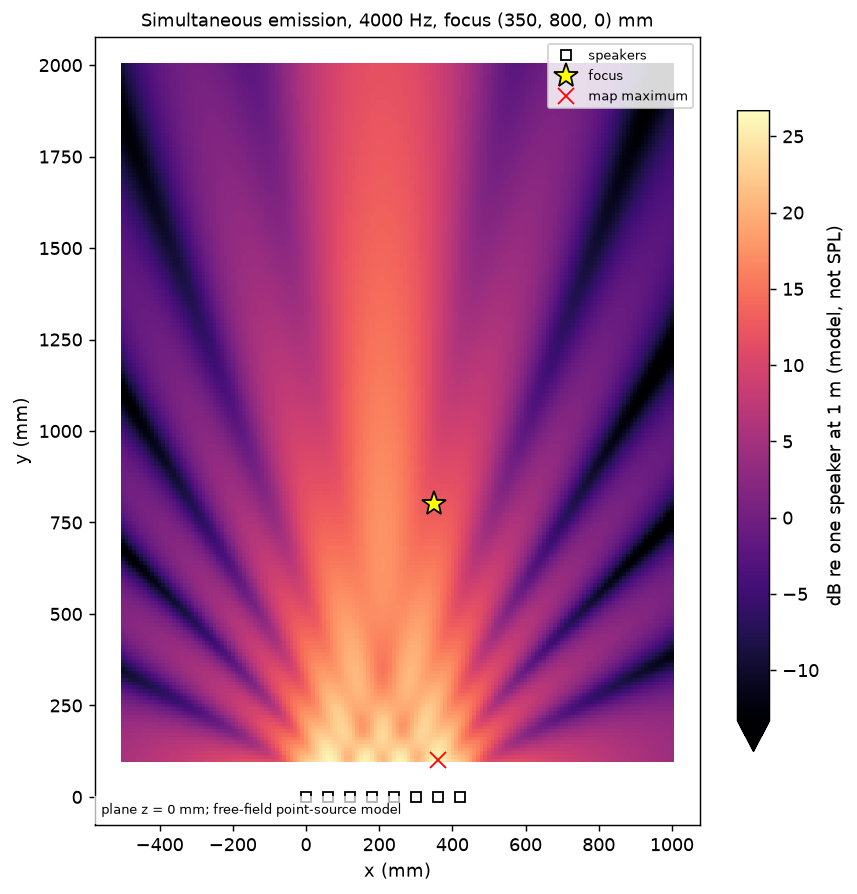
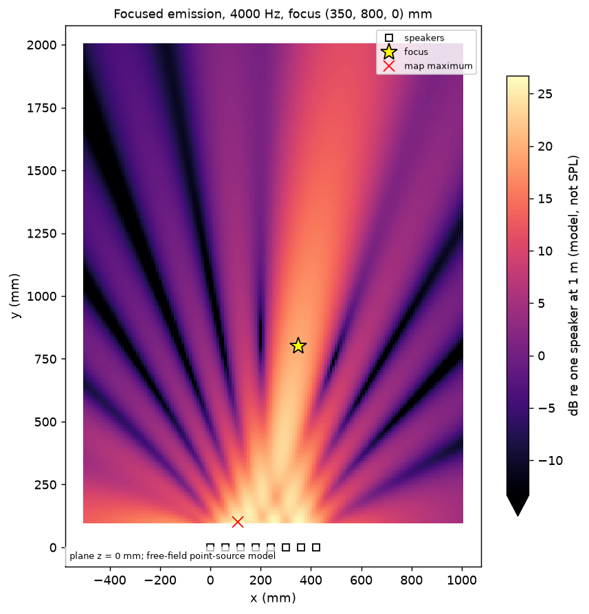
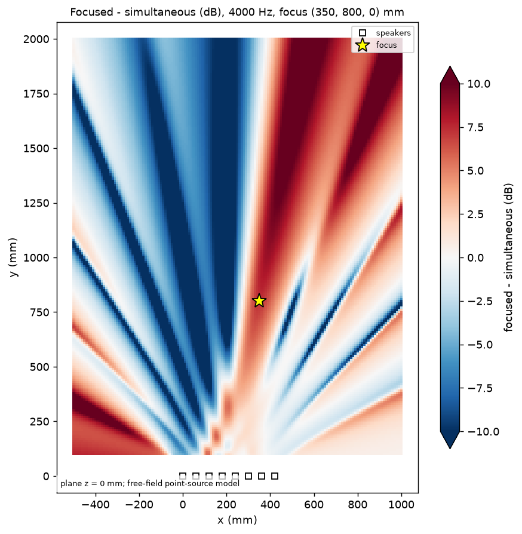

# Two-dimensional field maps

*[maujabur/bean-forming-lab](https://github.com/maujabur/bean-forming-lab) · made with Kiro*

`bean-lab field-map` computes the steady-state pressure of a sinusoidal tone on a plane in front of the array and renders three top-view PNG maps: simultaneous emission, focused emission, and their difference in dB. It needs no audio hardware.

**The maps are predictions of a free-field, point-source model, in dB relative to one speaker heard at 1 m. They are not measurements and not dB SPL.**

## Model

For a tone `A sin(w (t - e_i))` at each speaker (`A` = `--gain` at 1 m, `e_i` = focusing delay, zero if simultaneous), the pressure at a point at distances `r_i` is

```
p(t) = |P| sin(w t + arg P),    P = sum_i  A (1 m / r_i) exp(-j w (e_i + r_i / c))
```

This is exactly the steady state of the virtual microphone (`docs/virtual-microphone.md`): `|P|` is the amplitude, `arg P` the phase, `|P| / sqrt(2)` the RMS. The emission delays are the ones from `focus.focus_delays` (Mission 01). The phasor is evaluated analytically and vectorized with NumPy; no WAV is synthesized per point.

Levels: `L = 20 log10(|P| / A)`. 0 dB is one speaker at 1 m; eight perfectly coherent speakers at 1 m would give +18.06 dB. Distances below 1 m give more than the nominal level because of `1/r`.

## Coordinates and orientation

Millimeters in the array frame, as everywhere in the project. The plane is `z = --z` (default 0). The image is a top view of the XY plane: **x to the right, y up (away from an array placed along the x axis at y = 0)**; speakers are drawn as squares outside the mapped region, the focus as a star. Arrays are `(ny, nx)` in the data (row = y).

## Experiment 1

Array `configs/arrays/line-8-60mm.json`: eight speakers, 60 mm centers, x = 0 to 420 mm, y = z = 0. 4 kHz (wavelength 85.75 mm at 343 m/s, so the 60 mm pitch is 0.70 wavelengths), gain 0.05 at 1 m, focus (350, 800, 0) mm, region x -500..1000, y 100..2000 mm, 151 x 191 points (10 mm steps).

```bash
.venv/bin/bean-lab field-map \
  --array configs/arrays/line-8-60mm.json \
  --target 350 800 0 \
  --frequency 4000 --gain 0.05 --speed-of-sound 343 \
  --x-range -500 1000 --y-range 100 2000 --nx 151 --ny 191 \
  --probe 0 800 0 --probe 350 1500 0 --probe 700 800 0 --probe 210 800 0 --probe -300 1200 0 \
  --outdir /tmp/field
```

Outputs: `field-simultaneous.png`, `field-focused.png`, `field-difference.png`, `field-data.npz` (x_mm, y_mm, complex `simultaneous` and `focused`, dB arrays, `difference_db`, JSON `parameters`). Copies of the PNGs are in `docs/images/`.





### Values (exact points, not grid-snapped)

| Point (mm) | Simultaneous (dB) | Focused (dB) | Difference (dB) |
|---|---|---|---|
| focus (350, 800) | 12.49 | 19.76 | +7.26 |
| (0, 800) | 11.63 | 2.14 | -9.49 |
| (350, 1500) | 10.02 | 11.43 | +1.41 |
| (700, 800) | -3.23 | -9.16 | -5.93 |
| (210, 800), array axis | 17.36 | -3.50 | -20.86 |
| (-300, 1200) | -2.55 | -12.15 | -9.60 |

At the focus the delays make all eight contributions arrive in phase, so the focused level is the coherent sum `20 log10(sum 1/r_i) = 19.76 dB` (checked analytically in the tests). Map maxima: simultaneous +25.95 dB at (360, 100) mm; focused +26.68 dB at (110, 100) mm. **Both global maxima are in the near field next to the speakers, not at the focus** (the focus is not the loudest point of the map, because `1/r` is much larger close to the array). Focusing raises the focus by 7.26 dB relative to simultaneous emission, but it also moves energy away from other places, e.g. -20.9 dB on the array axis.

## Consistency with the virtual microphone

`tests/test_field.py` records 0.5 s of a 4 kHz sine with `microphone.receive` at several points, projects it on sin/cos over whole periods and compares amplitude and phase with the field model. Four points, both emission modes, run manually here:

| Point (mm) | Mode | Mic amplitude | Field amplitude | Relative difference | Phase difference (rad) |
|---|---|---|---|---|---|
| (350, 800) | simultaneous | 0.210701 | 0.210701 | 1.7e-6 | 9e-8 |
| (350, 800) | focused | 0.486275 | 0.486273 | 3.0e-6 | 2e-6 |
| (0, 800) | simultaneous | 0.190701 | 0.190700 | 2.5e-6 | 8e-7 |
| (0, 800) | focused | 0.063958 | 0.063958 | 4.2e-6 | 9e-7 |
| (350, 1500) | simultaneous | 0.158500 | 0.158499 | 2.2e-6 | 9e-8 |
| (350, 1500) | focused | 0.186426 | 0.186426 | 1.9e-6 | 4e-7 |
| (700, 800) | simultaneous | 0.034476 | 0.034476 | 5.9e-6 | 6e-6 |
| (700, 800) | focused | 0.017416 | 0.017417 | 1.2e-5 | 2e-5 |

The tests assert 2e-4. The small differences come from the finite-length interpolation filter of the time-domain microphone.

## Reading and adjusting the display

- The two level maps share one absolute color scale: top = the maximum over both maps, bottom = top minus `--range-db` (default 40). `--vmax` and `--range-db` change only the display; the NPZ data and dB arrays are identical (tested). Because the nearest-field values are large, lowering `--vmax` (for example `--vmax 20 --range-db 40`) reveals the interference pattern in the far region; values above the top saturate.
- The difference map is diverging, centered at 0 dB (white), spanning `+/- --diff-limit` (default 10 dB); red = focusing is louder, blue = quieter.
- Near-zero values: dB arrays clamp |P| at `--floor-db` (default -60 dB re 0 dB reference) so exact cancellations stay finite. The complex data are never clamped. The difference is undefined (gray, NaN) where both fields are below the floor.
- The red cross marks the map maximum, never assumed to be the focus.

## Limitations

Free field, ideal omnidirectional point sources, equal amplitudes, no reflections, directivity, transducer response, air absorption, or temperature dependence; only steady-state sinusoids (no transients); a plane, with z fixed. The 10 mm grid undersamples nothing at 4 kHz (wavelength 85.75 mm) but fine nulls can fall between grid points; use `--probe` or a finer grid for exact values. Pixels are drawn without interpolation. Fan-shaped lobes and nulls are interference patterns of this particular aperture and spacing; they were not analyzed in terms of grating lobes here.
