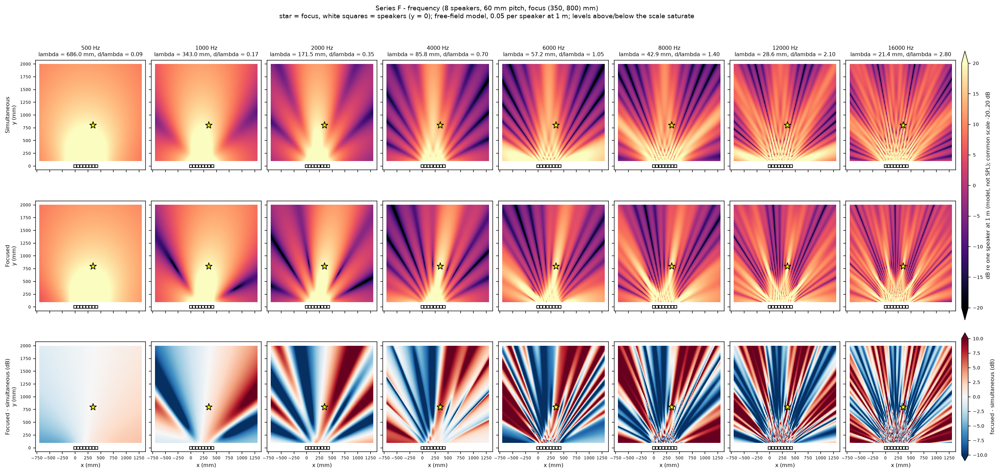
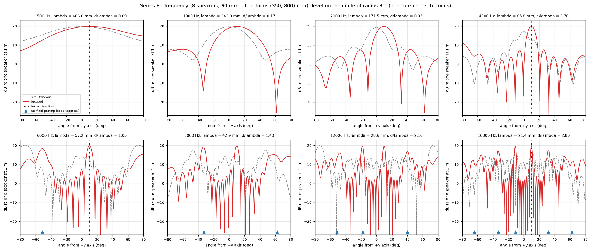
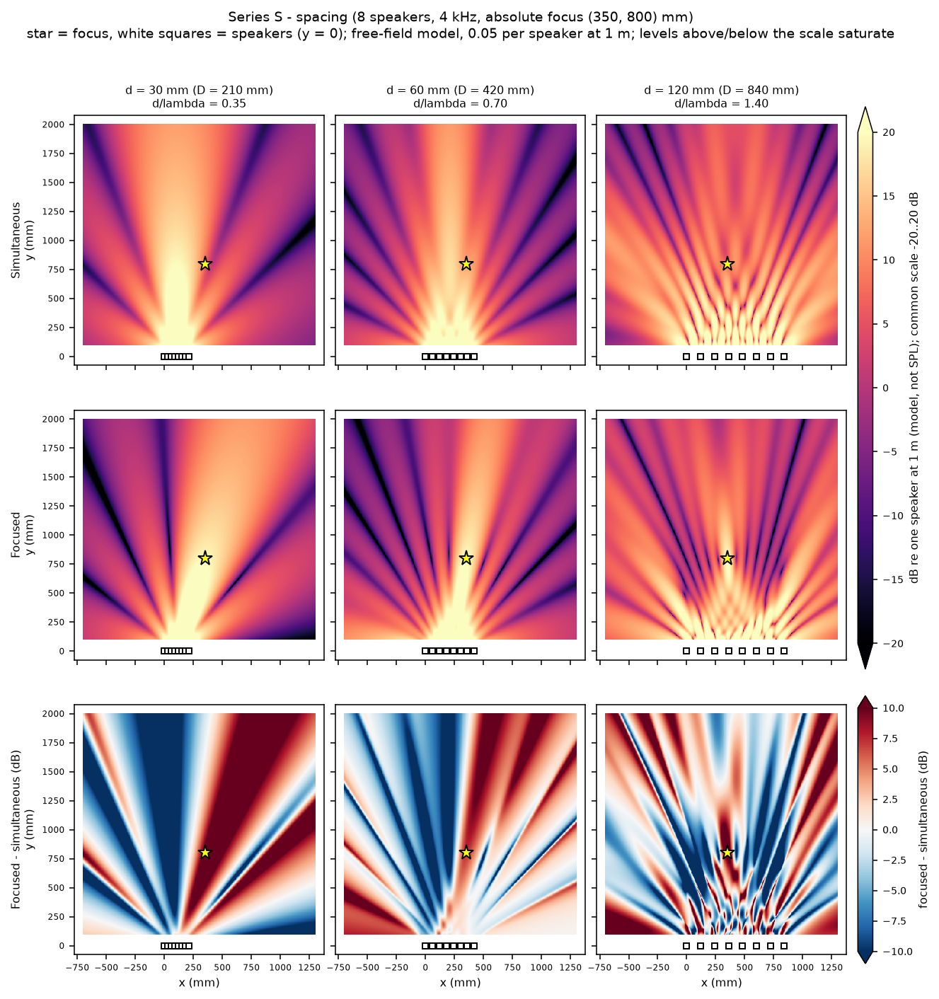
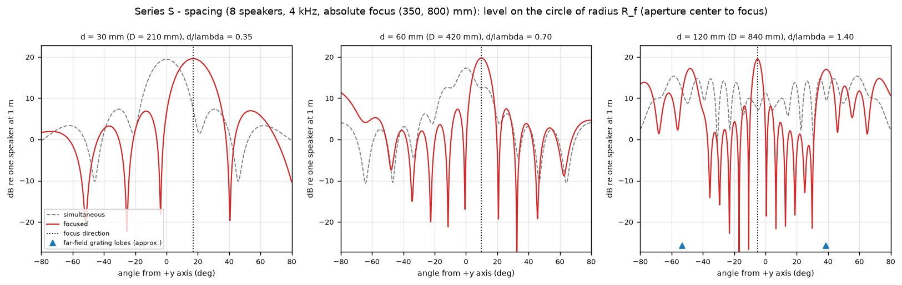
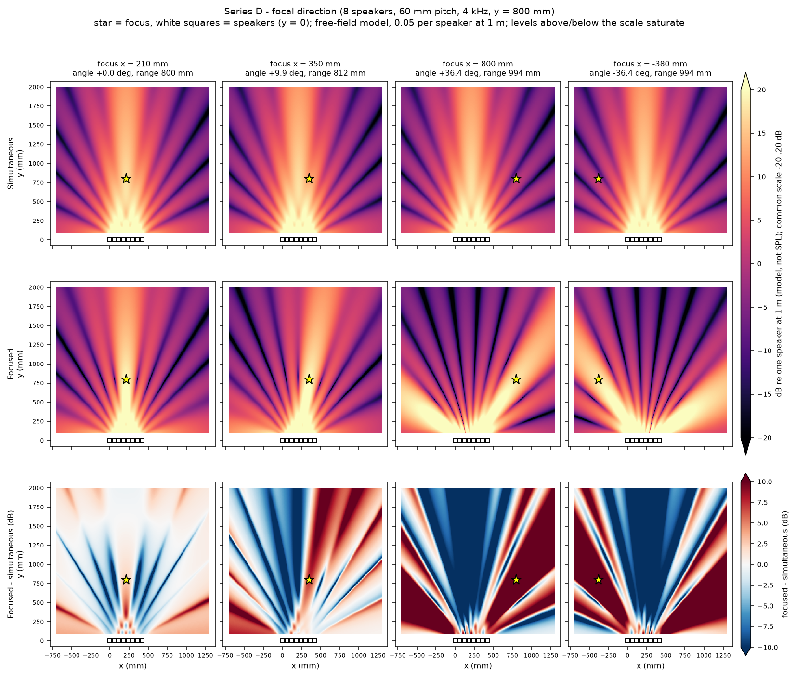
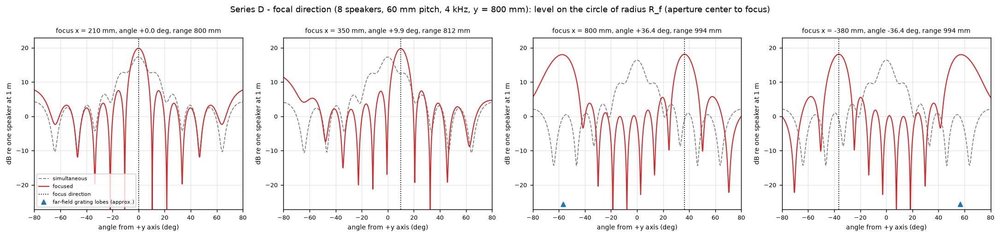

# Parametric beamforming study

*[maujabur/bean-forming-lab](https://github.com/maujabur/bean-forming-lab) · made with Kiro*

Simulated pressure fields of an 8-speaker line array as functions of frequency (series F), element spacing (series S) and focal direction (series D). Everything is the free-field, ideal point-source model of `docs/field-map.md`: **predictions, not measurements, in dB relative to one speaker heard at 1 m**.

## Reproduction

```bash
.venv/bin/bean-lab campaign --outdir results/parametric          # all series, about 2 minutes
.venv/bin/bean-lab campaign --series F --outdir results/parametric --oversample 4 --vmax 20 --range-db 40 --diff-limit 10
```

Region for every scenario: x -700..1300 mm, y 100..2000 mm, z = 0, 401 x 381 points (5 mm), c = 343 m/s, 0.05 per speaker at 1 m. Arrays: `configs/arrays/line-8-{30,60,120}mm.json`. `results/` is git-ignored (about 120 MB: complex fields, per-scenario PNGs, `data.npz` with the arc patterns). Versioned here: the plates and arc plots (`docs/images/parametric/`) and the indicators (`docs/data/indicators.csv`, `.json`). The run is deterministic; the tests check bit-identical repeats.

Color scales are common to **all** scenarios and both field rows: -20..20 dB (`--vmax 20 --range-db 40`); levels above 20 dB (the whole near field) saturate, shown by the arrow on the colorbar. The difference rows span +/-10 dB, centered at 0. These options change only the display; the data are untouched (tested). The `--vmax 20` setting makes lateral lobes and nulls readable, at the cost of saturating the beam close to the array; the focus itself (19.76 dB) stays just inside the scale.

## Experiments

| Series | Varies | Fixed |
|---|---|---|
| F | 500, 1000, 2000, 4000, 6000, 8000, 12000, 16000 Hz | 60 mm pitch, focus (350, 800, 0) |
| S | pitch 30, 60, 120 mm (apertures 210, 420, 840 mm) | 4 kHz, **absolute** focus (350, 800, 0) |
| D | focus x = 210, 350, 800, -380 mm | 60 mm pitch, 4 kHz, y = 800 |

Series S does not isolate the spacing effect: the aperture center moves (105, 210, 420 mm), so the same absolute focus lies at +17.0, +9.9 and -5.0 degrees and at 837, 812 and 803 mm range. Results of S mix spacing, aperture and relative focus direction.

**Series D symmetry.** The mission notes that x = 800 and x = -380 are not symmetric about the aperture center. They are: the center of the 60 mm array is x = 210 mm, and 2 x 210 - 800 = -380. The two cases are exact mirror images (verified numerically: identical indicators, mirrored fields and arcs). What breaks the mirror in the images is only the region, which is centered at x = 300 mm rather than 210 mm. The mirror of x = 350 would be x = 70 (not a campaign case; the tests check that pair too).

## Indicators and their definitions

Levels in dB re one speaker at 1 m. Angles are measured at the aperture center from the +y axis toward +x. `R_f` is the distance from the aperture center to the focus.

- **Focus level and focusing gain**: field at the exact focus; gain = focused - simultaneous at that point. The gain compares emission schemes at one point; it is not a figure of merit by itself, because the simultaneous field there depends on where the focus sits in the simultaneous pattern (see the analysis).
- **Global maximum**: highest value over the region, found on a grid four times finer than the images (1.25 mm) and refined locally to about 1 micrometre. Whenever it lies at the y = 100 mm edge it is only the region boundary cutting the near field; it is not a sidelobe.
- **Arc analysis**: levels on the circle of radius `R_f` around the aperture center, |angle| <= 80 degrees in 0.02 degree steps. A constant radius removes the `1/r` trend, so what remains is directivity. The main lobe is the lobe holding the arc peak, bounded by the first minima; sidelobes are the local maxima outside it; **contrast = arc peak - highest sidelobe**; the beam width is the -3 dB width of the main lobe.
- **Band sidelobe**: the arc analysis repeated on 21 circles with radii from 0.75 R_f to 1.25 R_f, each excluding its own main lobe (so the converging beam, an hourglass in the near field, is excluded as a whole), with the level compensated for spherical spreading by `20 log10(r / R_f)`. It is the highest compensated sidelobe in the band; `band contrast = focus level - it`. Because the band stays at least 0.75 R_f away from the array, the geometric near-field maxima are excluded by construction. (A first attempt with a fixed angular exclusion sector was discarded: it counted the wide part of the converging main lobe as a sidelobe.)
- **Predicted grating lobes**: far-field directions `sin(theta) = sin(theta_focus) + m lambda / d`, |sin| <= 1, m != 0. All apertures here are within their near field (the Fraunhofer distance `2 D^2 / lambda` is 4.1 m for D = 420 mm at 4 kHz), so these are approximations; they are compared with the measured arcs below.

## Plates

Series F, frequency:





Series S, spacing:





Series D, focal direction:





(In the arc plots the blue triangles mark the predicted grating-lobe directions, the dotted line the focus direction.)

## Results

### Geometry

| Scenario | f (Hz) | lambda (mm) | d (mm) | d/lambda | D (mm) | focus angle (deg) | R_f (mm) |
|---|---|---|---|---|---|---|---|
| F/f00500 | 500 | 686.0 | 60 | 0.09 | 420 | +9.9 | 812 |
| F/f01000 | 1000 | 343.0 | 60 | 0.17 | 420 | +9.9 | 812 |
| F/f02000 | 2000 | 171.5 | 60 | 0.35 | 420 | +9.9 | 812 |
| F/f04000 | 4000 | 85.8 | 60 | 0.70 | 420 | +9.9 | 812 |
| F/f06000 | 6000 | 57.2 | 60 | 1.05 | 420 | +9.9 | 812 |
| F/f08000 | 8000 | 42.9 | 60 | 1.40 | 420 | +9.9 | 812 |
| F/f12000 | 12000 | 28.6 | 60 | 2.10 | 420 | +9.9 | 812 |
| F/f16000 | 16000 | 21.4 | 60 | 2.80 | 420 | +9.9 | 812 |
| S/d030 | 4000 | 85.8 | 30 | 0.35 | 210 | +17.0 | 837 |
| S/d060 | 4000 | 85.8 | 60 | 0.70 | 420 | +9.9 | 812 |
| S/d120 | 4000 | 85.8 | 120 | 1.40 | 840 | -5.0 | 803 |
| D/x+210 | 4000 | 85.8 | 60 | 0.70 | 420 | +0.0 | 800 |
| D/x+350 | 4000 | 85.8 | 60 | 0.70 | 420 | +9.9 | 812 |
| D/x+800 | 4000 | 85.8 | 60 | 0.70 | 420 | +36.4 | 994 |
| D/x-380 | 4000 | 85.8 | 60 | 0.70 | 420 | -36.4 | 994 |

### Focus level, gain and global maximum

"Image grid" is the maximum over the 5 mm image grid, "refined" the one from the fine search.

| Scenario | Simultaneous at focus | Focused at focus | Focusing gain | Max focused, image grid -> refined | Position (mm) | Range from center (mm) |
|---|---|---|---|---|---|---|
| F/f00500 | 19.53 | 19.76 | +0.22 | 34.09 -> 34.09 | (242, 100) | 105 |
| F/f01000 | 18.86 | 19.76 | +0.90 | 32.65 -> 32.65 | (252, 100) | 108 |
| F/f02000 | 16.14 | 19.76 | +3.62 | 29.42 -> 29.42 | (160, 100) | 112 |
| F/f04000 | 12.49 | 19.76 | +7.26 | 26.72 -> 26.73 | (114, 100) | 139 |
| F/f06000 | 12.94 | 19.76 | +6.82 | 32.09 -> 32.10 | (91, 100) | 156 |
| F/f08000 | 10.97 | 19.76 | +8.79 | 30.17 -> 30.20 | (457, 100) | 267 |
| F/f12000 | 8.19 | 19.76 | +11.57 | 33.04 -> 33.13 | (69, 100) | 173 |
| F/f16000 | 8.95 | 19.76 | +10.81 | 31.53 -> 31.61 | (186, 124) | 126 |
| S/d030 | 7.47 | 19.59 | +12.12 | 32.59 -> 32.60 | (153, 100) | 111 |
| S/d060 | 12.49 | 19.76 | +7.26 | 26.72 -> 26.73 | (114, 100) | 139 |
| S/d120 | 7.25 | 19.52 | +12.27 | 28.93 -> 28.93 | (215, 100) | 228 |
| D/x+210 | 17.36 | 19.88 | +2.52 | 25.99 -> 25.99 | (210, 100) | 100 |
| D/x+350 | 12.49 | 19.76 | +7.26 | 26.72 -> 26.73 | (114, 100) | 139 |
| D/x+800 | -0.95 | 18.12 | +19.06 | 30.60 -> 30.65 | (162, 100) | 111 |
| D/x-380 | -0.95 | 18.12 | +19.06 | 30.60 -> 30.65 | (258, 100) | 111 |

### Directivity and sidelobes on the focal arc

| Scenario | Arc peak (dB @ deg) | -3 dB width (deg) | Highest arc sidelobe (dB @ deg) | Arc contrast (dB) | Band sidelobe (dB) | Band contrast (dB) | Predicted grating lobes (deg) |
|---|---|---|---|---|---|---|---|
| F/f00500 | 19.76 @ +10.5 | 85.1 | none | n/a | n/a | n/a | none |
| F/f01000 | 19.76 @ +10.1 | 38.9 | 7.70 @ -60.4 | 12.06 | 8.04 | 11.72 | none |
| F/f02000 | 19.76 @ +10.0 | 19.1 | 7.57 @ +43.8 | 12.19 | 7.81 | 11.95 | none |
| F/f04000 | 19.76 @ +9.9 | 9.5 | 7.43 @ +25.8 | 12.33 | 8.28 | 11.48 | none |
| F/f06000 | 19.76 @ +9.9 | 6.3 | 18.28 @ -51.3 | 1.48 | 19.10 | 0.66 | -51.3 |
| F/f08000 | 19.76 @ +9.9 | 4.8 | 19.19 @ -33.5 | 0.56 | 19.55 | 0.21 | -32.8, +62.5 |
| F/f12000 | 19.76 @ +9.9 | 3.2 | 19.63 @ -18.3 | 0.13 | 19.68 | 0.08 | -51.3, -17.7, +40.4 |
| F/f16000 | 19.76 @ +9.9 | 2.4 | 19.68 @ -11.2 | 0.08 | 19.68 | 0.08 | -64.1, -32.8, -10.7, +32.0, +62.5 |
| S/d030 | 19.59 @ +17.0 | 19.3 | 6.96 @ +53.7 | 12.63 | 7.01 | 12.58 | none |
| S/d060 | 19.76 @ +9.9 | 9.5 | 7.43 @ +25.8 | 12.33 | 8.28 | 11.48 | none |
| S/d120 | 19.52 @ -5.0 | 5.1 | 17.20 @ -48.1 | 2.32 | 17.96 | 1.56 | -53.3, +38.9 |
| D/x+210 | 19.88 @ -0.0 | 9.4 | 7.51 @ +15.4 | 12.36 | 8.36 | 11.52 | none |
| D/x+350 | 19.76 @ +9.9 | 9.5 | 7.43 @ +25.8 | 12.33 | 8.28 | 11.48 | none |
| D/x+800 | 18.12 @ +36.4 | 11.3 | 18.00 @ -57.4 | 0.11 | 18.09 | 0.02 | -56.7 |
| D/x-380 | 18.12 @ -36.4 | 11.3 | 18.00 @ +57.4 | 0.11 | 18.09 | 0.02 | +56.7 |

At 500 Hz the main lobe covers the whole arc, so no sidelobe exists.

## Analysis

**Frequency (series F).** The level at the focus is the same, 19.76 dB, at every frequency: it is the coherent sum `20 log10(sum 1/r_i)`, set by the geometry only. What changes is everything around it.
- 500 Hz: the wavelength (686 mm) exceeds the aperture (420 mm); the pattern is almost omnidirectional (-3 dB width 85 degrees) and the delays barely matter (+0.22 dB). Focusing is not meaningful there.
- 1 to 4 kHz (d/lambda 0.17 to 0.70): a single main lobe that narrows with frequency (38.9, 19.1, 9.5 degrees), with the first sidelobes about 12 dB below it, as for a uniform 8-element line. The gain of focusing over simultaneous emission grows from +0.9 to +7.3 dB.
- 6 kHz and above (d/lambda > 1): grating lobes appear. The highest arc sidelobe is within 1.5 dB of the main lobe at 6 kHz and within 0.13 dB at 12 kHz and above, at the predicted directions (6 kHz: -51.3 predicted and measured; 8 kHz: -32.8 vs -33.5; 12 kHz: -17.7 vs -18.3; 16 kHz: -10.7 vs -11.2 degrees). The main lobe keeps narrowing (2.4 degrees at 16 kHz) but is no longer the only strong lobe: the space contains several equally strong beams. The 5 mm image grid is also close to its limit for these wavelengths (21 mm at 16 kHz is only 4 pixels per wavelength): nulls and narrow lobes in these panels are partly undersampled, while the indicators use the finer grid.
- The simultaneous emission already has grating lobes above 6 kHz; there the largest simultaneous lobe is not even in front of the array (peak at -73 degrees at 6 kHz, +47 degrees at 8 kHz). "Focusing gain" at the focus is partly an artifact of the simultaneous field being low at that point (8.2 to 12.9 dB, against a simultaneous maximum of up to 20 dB elsewhere on the arc), not a property of the focused beam alone.

**Spacing (series S).** With 8 elements the pitch sets the aperture, so the two cannot be separated.
- 30 mm (210 mm aperture): no grating lobes, but a broad main lobe (19.3 degrees) and a large gain over simultaneous emission (+12.1 dB, comparable to +12.3 dB at 120 mm), because at +17 degrees the simultaneous field has already fallen to 7.5 dB. Sidelobes 12.6 dB down.
- 60 mm (420 mm): 9.5 degrees, sidelobes 12.3 dB down, no grating lobes at this steering.
- 120 mm (840 mm): the narrowest main lobe (5.1 degrees) but d/lambda = 1.4: grating lobes at -53 and +39 degrees predicted (measured highest sidelobe at -48.1 degrees, 2.3 dB below the main lobe). The 5 degree difference between predicted and measured angle is consistent with the near-field geometry (focus at 803 mm against an 840 mm aperture); the far-field formula is not accurate here. The pattern in the plate is dominated by a lattice of lobes.
- Because the absolute focus is fixed, the 30 mm array sees it 17 degrees off axis and the 120 mm array 5 degrees: the focusing gains (+12.1, +7.3, +12.3 dB) mostly reflect where the focus sits in each simultaneous pattern, not the spacing.

**Direction (series D).**
- Focus level: 19.88 dB (x = 210, range 800 mm), 19.76 dB (x = 350, 812 mm), 18.12 dB (x = 800 and x = -380, 994 mm). The drop of 1.64 dB from 19.76 to 18.12 is within 0.12 dB of the 1.76 dB spherical-spreading difference between the ranges, so the loss is almost entirely distance (more `1/r` loss), not a weaker beam. This is exactly the geometric effect that should not be credited to focusing.
- The central and moderately lateral foci have equal contrast (12.4 and 12.3 dB) and widths (9.4 and 9.5 degrees); the pattern simply tilts.
- At 36.4 degrees the beam widens (11.3 degrees) and a grating lobe appears at 57.4 degrees (predicted 56.7) at the same level as the main lobe (contrast 0.11 dB, band contrast 0.02 dB). Steering to a large angle with `d/lambda = 0.70` violates the grating-free condition `d/lambda < 1/(1 + |sin theta|)` (0.63 at 36.4 degrees). A second beam of equal level points to the other side of the array.
- The large "gain" there (+19.06 dB) comes from the simultaneous field being at a low value in that direction (-0.95 dB); it should not be read as a better beam.

**Why focused maxima are in the near field.** In all 15 scenarios the highest focused level (25.99 to 34.09 dB) is 100 to 270 mm from the aperture center, 6 to 14 dB above the level at the focus, and mostly sits on the y = 100 mm boundary of the region. With a point-source `1/r` law, being close to any speaker dominates; the focus is never the global maximum. The meaningful comparison is the focus against the lobes on the same arc, which the contrast indicators provide.

## Grating lobes

Spatial aliasing occurs when the pitch exceeds the wavelength seen along a steering direction: `d/lambda >= 1/(1 + |sin theta|)`. For the three pitches the limit frequencies (`c / (d (1 + |sin theta|))`, Hz) are:

| Pitch | theta = 0 | 9.9 degrees | 17.0 degrees | 36.4 degrees | 60 degrees |
|---|---|---|---|---|---|
| 30 mm | 11433 | 9756 | 8847 | 7175 | 6127 |
| 60 mm | 5717 | 4878 | 4423 | 3588 | 3064 |
| 120 mm | 2858 | 2439 | 2212 | 1794 | 1532 |

The campaign confirms the criterion: 60 mm at 4 kHz is grating-free at 9.9 degrees (limit 4878) but not at 36.4 degrees (limit 3588); at 6 kHz it already fails at 9.9 degrees. The rule is a far-field approximation; with focusing at 0.8 to 1 m the measured lobe angles deviated by up to 0.7 degrees for the 60 mm array and 5 degrees for the 840 mm aperture.

## Limitations

- Free-field point sources with identical amplitudes: no reflections, driver directivity, diffraction around a baffle, transducer response, mutual coupling or air absorption. The real drivers have a physical size, which also bounds how small the pitch can be.
- Steady-state tones in the plane z = 0 only; no transient behavior and no vertical (z) pattern, although the real array is three dimensional.
- Levels are relative, not dB SPL; there is no calibration against microphone measurements. Real channel gain and delay mismatches (still unmeasured) would change the nulls first.
- The images use a 5 mm grid. Maxima are refined, but the depth of the nulls is not quantified, and at 12 kHz and 16 kHz the images undersample the finest structure (wavelength 28.6 and 21.4 mm).
- The arc and band indicators are defined in the plane of the array line and at ranges close to the focus. Sidelobes are lobes outside the first-minimum-bounded main lobe; with several equal grating lobes the "main lobe" is the one holding the maximum, which in some simultaneous cases is not the one in front of the array.
- Arc and band circles are not clipped to the image region.
- The far-field grating formula is only a guide; use the arcs for the actual angles.

## Implications for the physical array

These are inputs for the decision, not a recommendation of a final geometry.

- **No single best pitch.** The pitch trades the frequency range without grating lobes against the beam width. With 60 mm, the grating-free range at moderate steering ends near 3.6 to 4.9 kHz and the beam at 4 kHz is 9.5 degrees wide. With 30 mm the range extends to 7 to 11 kHz but the beam at 4 kHz is twice as wide (19 degrees). With 120 mm the useful range ends near 1.8 to 2.9 kHz, and 4 kHz already splits the energy.
- **Frequency range of the experiment.** Below about 1 kHz the 420 mm aperture does almost nothing (gain below 1 dB at 500 Hz, beam over 38 degrees at 1 kHz). A tone around 2 to 4 kHz is the sweet spot for 60 mm, with 8 speakers.
- **Steering range.** The extreme lateral focus (36 degrees) already produces an equal grating lobe at 4 kHz for 60 mm. To explore that region either reduce the frequency (below about 3.5 kHz), reduce the pitch, or accept the double beam.
- **Mechanical viability.** The drivers must physically fit in the chosen pitch. A 30 mm pitch requires drivers (including frame) smaller than 30 mm, which in practice are small full-range units with limited low-frequency output. Not yet checked against the actual drivers.
- **Variables the model cannot decide.** Non-uniform spacing, more elements, a second row (3D) or driver directivity may suppress grating lobes better than changing the pitch; they are outside this campaign.
- **Before building:** measure inter-channel delay and gain mismatch of the interface and the driver responses, then repeat the campaign with the corrected model and compare a few points (the focus and one null) with a microphone.

## Conclusion

Frequency, spacing and steering direction act through one rule: the grating lobes appear when `d/lambda >= 1/(1 + |sin theta|)`. For the 60 mm array this limit is 5717 Hz at broadside, 4878 Hz at 9.9 degrees and 3588 Hz at 36.4 degrees, and the simulated arcs confirm it (above it the highest competing lobe is within 1.5 dB of the main lobe, and for the 4 kHz tone steered to x = 800 mm it reaches 0.11 dB). The level at the focus is the same coherent sum at every frequency; what changes is the beam width and the contrast, about 12 dB for a grating-free uniform line. The series mix aperture, spacing and relative direction (the absolute focus is fixed), so they point to compromises rather than to a single best geometry: a small pitch avoids gratings but widens the beam, a large pitch narrows it and brings gratings in. All numbers are free-field predictions awaiting a measurement.
